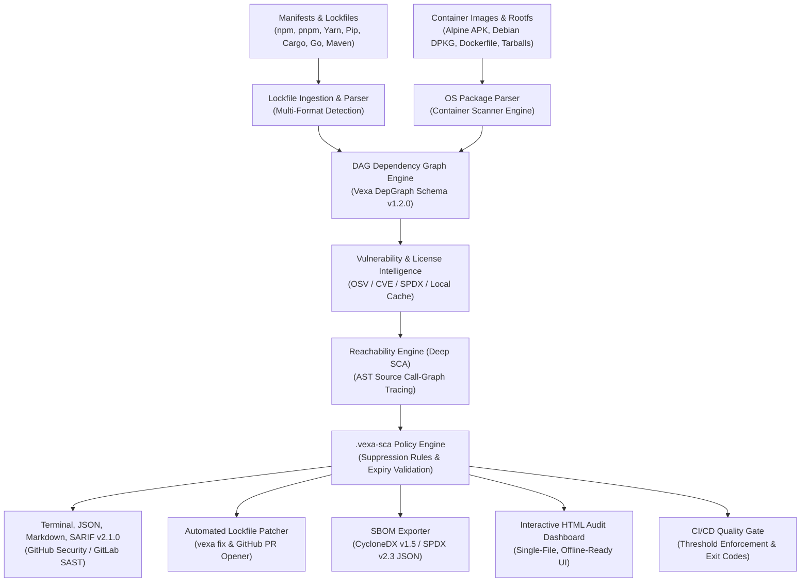

# Vexa: Software Composition Analysis & Security Engine

[](https://www.rust-lang.org/)
[](LICENSE)
[](#cross-platform-installation--setup)
[](#automated-tests--verification)
[](#option-2-run-via-nodejs--npx-wrapper-all-platforms)

A commercial-grade, blazingly fast Software Composition Analysis (SCA) tool built with a native **Rust Core Engine** (`vexa`, with backwards-compatible aliases `vexa-sca` and `sca`) and an optional cross-platform Node.js launcher. Detect vulnerabilities across 6+ package ecosystems, verify runtime function reachability to eliminate false positives, audit copyleft licenses, generate industry-standard SBOMs, inspect container filesystems and tarballs, enforce CI/CD quality gates, and automatically patch lockfiles or open GitHub pull requests.

---

## Table of Contents
- [Quick Start](#quick-start)
- [Cross-Platform Installation & Setup](#cross-platform-installation--setup)
  - [Prerequisites by OS](#prerequisites-by-os)
  - [Building from Source](#building-from-source)
  - [Runnincg the CLI](#running-the-cli)
- [Architecture & Core Concepts](#architecture--core-concepts)
- [Multi-Ecosystem Coverage](#multi-ecosystem-coverage)
- [Key Features](#key-features)
  - [1. Reachability Analysis (Deep SCA)](#1-reachability-analysis-deep-sca)
  - [2. Automated Lockfile Patcher & PR Opener (`fix`)](#2-automated-lockfile-patcher--pr-opener-fix)
  - [3. Policy & Suppression Engine (`.vexa-sca`)](#3-policy--suppression-engine-vexa-sca)
  - [4. License Compliance Scanner](#4-license-compliance-scanner)
  - [5. Software Bill of Materials (SBOM: CycloneDX & SPDX)](#5-software-bill-of-materials-sbom-cyclonedx--spdx)
  - [6. Standalone Interactive HTML Audit Dashboard](#6-standalone-interactive-html-audit-dashboard)
  - [7. CI/CD Quality Gates & Policy Enforcement](#7-cicd-quality-gates--policy-enforcement)
  - [8. Container & OS Package Scanner (`container`)](#8-container--os-package-scanner-container)
- [CLI Reference](#cli-reference)
  - [`scan`](#1-vexa-scan)
  - [`fix`](#2-vexa-fix)
  - [`licenses`](#3-vexa-licenses)
  - [`graph`](#4-vexa-graph)
  - [`test`](#5-vexa-test)
  - [`container`](#6-vexa-container)
- [CI/CD Integration](#cicd-integration)
  - [GitHub Actions (with Native SARIF Upload & Quality Gate)](#github-actions-with-native-sarif-upload--quality-gate)
  - [GitLab CI](#gitlab-ci)
- [Automated Tests & Verification](#automated-tests--verification)

---

## Quick Start

### Option 1: Native Rust Binary (Recommended for CI & High Performance)

#### Linux / macOS
```bash
# Build optimized native release binaries (`vexa`, `vexa-sca`, `sca`)
cargo build --release

# Run scan against current project using primary binary `vexa`
./target/release/vexa scan

# Or run directly with Cargo
cargo run --bin vexa -- scan
```

#### Windows (PowerShell / CMD)
```powershell
# Build optimized native release binaries
cargo build --release

# Run scan against current project (PowerShell)
.\target\release\vexa.exe scan

# Or run directly with Cargo
cargo run --bin vexa -- scan
```

> [!TIP]
> **Backwards-Compatible Aliases**: Both `vexa-sca` and `sca` are compiled as native binary aliases alongside `vexa`. You can invoke `./target/release/vexa-sca scan` or `./target/release/sca scan` identically.

### Option 2: Run via Node.js / NPX Wrapper (All Platforms)

Vexa includes a cross-platform shim (`bin/vexa.js`) registered in `package.json`. It automatically resolves the native executable on **Windows**, **macOS**, and **Linux**, falling back to `cargo run` if uncompiled:

```bash
# Using Node.js directly
node bin/vexa.js scan

# Using npm scripts
npm run scan

# If published or linked globally
npx vexa scan
```

---

## Cross-Platform Installation & Setup

Vexa is fully cross-platform and operates identically on **Linux** (x86_64, aarch64, musl/Alpine, glibc), **macOS** (Apple Silicon M-series & Intel), and **Windows** (PowerShell, Command Prompt, Git Bash, WSL).

> [!NOTE]
> **Zero External C / OpenSSL Dependencies**: Vexa uses a pure Rust TLS implementation (`rustls-tls`) and pure Rust decompression (`miniz_oxide`). You do not need to install Perl, OpenSSL dev headers, or build tools like MSVC C++ SDK solely for cryptographic handshakes or tarball unpacking.

### Prerequisites by OS

| Operating System | Recommended Rust Installation | Optional Node.js (for `npx` wrapper) |
| :--- | :--- | :--- |
| **Linux** (Ubuntu, Debian, Fedora, Arch, Alpine) | `curl --proto '=https' --tlsv1.2 -sSf https://sh.rustup.rs \| sh` | `v16.0.0+` (via `nvm` or package manager) |
| **macOS** (Apple Silicon M1-M4 & Intel) | `curl --proto '=https' --tlsv1.2 -sSf https://sh.rustup.rs \| sh` | `brew install node` |
| **Windows** (10 / 11, Server) | `winget install Rustlang.Rustup` or download [rustup-init.exe](https://rustup.rs) | `winget install OpenJS.NodeJS.LTS` |

### Building from Source

```bash
# Clone the repository
git clone https://github.com/your-org/vexa.git
cd vexa-sca

# Compile release binaries (creates `vexa`, `vexa-sca`, and `sca`)
cargo build --release
```

Compiled binaries are located at:
- **Linux & macOS**: `target/release/vexa`, `target/release/vexa-sca`, and `target/release/sca`
- **Windows**: `target\release\vexa.exe`, `target\release\vexa-sca.exe`, and `target\release\sca.exe`

### Running the CLI

You can install the native binary to your user PATH using Cargo:
```bash
cargo install --path .
# Now available globally from any terminal:
vexa --help
```

---

## Architecture & Core Concepts



### Core Architectural Pillars
1. **DAG Dependency Representation**: Modeled after standard dep-graph schema (Schema v1.2.0). Every dependency node is mapped in a Directed Acyclic Graph with distinct `nodeId` and `pkgId` coordinates (`name@version`).
2. **Deep-Path DFS Tracing (`pkgPathsToRoot`)**: Transitive (nested) vulnerabilities trace their exact propagation chains back to the root application.
3. **Reachability Analysis (Deep SCA)**: Static AST inspection scans your actual source code to verify if the vulnerable function (e.g., `_.template`, `parse()`, `Session.request`) is invoked at runtime, eliminating up to 80% of false positives.
4. **Resilient Offline Cache**: Vulnerability lookups are cached on disk (`.sca-cache/`) with SHA-256 hashed keys to minimize network roundtrips and enable air-gapped CI scanning.
5. **Quality Gates & Policy Compliance**: Comprehensive policy evaluation that integrates seamlessly into automated CI/CD pipelines.

---

## Multi-Ecosystem Coverage

Vexa automatically identifies project manifests, lockfiles, and container images without manual configuration:

| Ecosystem | Supported Files | Detection & Features |
| :--- | :--- | :--- |
| **Node.js / JavaScript / TypeScript** | `package-lock.json` (v1, v2, v3)<br>`yarn.lock` (v1)<br>`pnpm-lock.yaml` (v5, v6, v9) | Full dependency tree, transitive dependencies, peer resolution, AST call-graph reachability |
| **Python** | `requirements.txt` | Specifiers (`==`, `>=`, `<=`, `~=`), comments, environment markers, Python AST reachability |
| **Go** | `go.sum`, `go.mod` | Go modules dependency tree, version extraction (`vX.Y.Z`) |
| **Rust** | `Cargo.lock` | TOML package blocks, workspace dependency resolution |
| **Java** | `pom.xml` | Maven XML coordinate parsing (`groupId:artifactId@version`) |
| **Container & OS Packages** | Alpine (`/lib/apk/db/installed`), Debian/Ubuntu (`/var/lib/dpkg/status`), Dockerfile, `.tar` / `.tar.gz` images | Linux distribution detection (`/etc/os-release`), OS package vulnerability auditing |

---

## Key Features

### 1. Reachability Analysis (Deep SCA)

Standard SCA tools flag every vulnerable package in your dependency tree, causing alert fatigue. Vexa's reachability engine inspects your source code (`.js`, `.jsx`, `.ts`, `.tsx`, `.py`) to identify if vulnerable functions are executed:

- `🚨 REACHABLE`: An active invocation was found in your code.
- `🛡️ UNREACHABLE`: The package is installed, but the vulnerable function is never called.

Filter directly in CLI:
```bash
# Focus strictly on exploitable vulnerabilities
vexa scan --reachable-only
```

---

### 2. Automated Lockfile Patcher & PR Opener (`fix`)

Remediate vulnerabilities automatically without breaking application builds:
- **Direct Upgrades**: Bumps direct package versions in `package.json` to the minimum non-vulnerable release.
- **Transitive Pinning via Overrides**: For nested dependencies, injects package manager `overrides` (npm) or `resolutions` (Yarn).
- **Automated Pull Requests**: Creates a git branch, commits the modified files, and opens a GitHub Pull Request with full vulnerability summaries.

```bash
# Preview proposed fixes without altering files
vexa fix --dry-run

# Apply fixes locally
vexa fix

# Automatically open a GitHub Pull Request
vexa fix --create-pr --repo owner/my-repo --token $GITHUB_TOKEN
```

---

### 3. Policy & Suppression Engine (`.vexa-sca`)

Manage false positives, accepted risks, or delayed remediations via YAML or JSON policy files:
- **Exact & Alias Matching**: Suppress by CVE ID (`CVE-2021-23337`), GHSA ID (`GHSA-35jh-r3h4-6jhm`), or Package ID (`lodash@4.17.15`).
- **Mandatory Expiration Date**: Set an `expires: YYYY-MM-DD`. Once expired, the suppression is automatically invalidated and the vulnerability re-alerts.
- **Native Format**: Supports both `.vexa-sca` (YAML) and `.vexa-sca.json` (JSON) policy specifications.

#### Example `.vexa-sca` (YAML):
```yaml
version: v1.0.0
ignore:
  CVE-2021-23337:
    - reason: "Command injection vector unreachable; untrusted input is sanitised at ingress"
      expires: 2026-12-31
  GHSA-29mw-wpgm-hmr9:
    - reason: "Internal microservice not exposed to public internet"
      expires: 2027-01-01
```

#### Example `.vexa-sca.json` (JSON):
```json
{
  "version": "v1.0.0",
  "ignore": {
    "CVE-2021-23337": [
      {
        "reason": "Untrusted input sanitized at ingress",
        "expires": "2026-12-31"
      }
    ]
  }
}
```

---

### 4. License Compliance Scanner

Categorize every third-party dependency by open source license and intellectual property risk:
- **Permissive (Low Risk)**: MIT, Apache-2.0, BSD-2/3-Clause, ISC, CC0, Unlicense. Safe for proprietary and commercial distribution.
- **Weak Copyleft (Medium Risk)**: LGPL-2.1/3.0, MPL-2.0, EPL-1.0/2.0, CDDL. Modifications to the library itself must typically remain open source.
- **Strong Copyleft (High Risk / Viral GPL)**: GPL-2.0/3.0, AGPL-3.0, SSPL, EUPL. Can obligate the entire proprietary project to be licensed as open source.

```bash
vexa licenses ./my-project
```

---

### 5. Software Bill of Materials (SBOM: CycloneDX & SPDX)

Generate industry-standard Software Bill of Materials compliant with executive cybersecurity orders and enterprise procurement standards:

- **CycloneDX v1.5 JSON**: Standardized components with Package URLs (`pkg:npm/lodash@4.17.15`), licenses, transitive dependency trees, and integrated vulnerability records with severity ratings and advisory URLs.
- **SPDX v2.3 JSON**: Official Linux Foundation SPDX document structure with packages, SPDX license identifiers, download locations, verification checksums, and `DEPENDS_ON` relationship graphs.

```bash
# Output CycloneDX v1.5 JSON to stdout
vexa scan --sbom cyclonedx

# Export CycloneDX SBOM directly to file
vexa scan --sbom cyclonedx --sbom-file sbom-cyclonedx.json

# Export SPDX v2.3 JSON directly to file
vexa scan --sbom spdx --sbom-file sbom-spdx.json
```

---

### 6. Standalone Interactive HTML Audit Dashboard

Generate a modern, self-contained, offline-ready HTML security report:
- **Zero External CDNs**: All CSS styles and interactivity are embedded directly in a single HTML file—perfect for air-gapped CI/CD artifacts and compliance audits.
- **Glassmorphism Dark Theme**: Sleek UI with KPI metrics cards, severity distribution progress bars, and high-contrast status tags.
- **Client-Side Live Filtering & Search**: Instant real-time search across packages, CVEs, and summaries, with filter tabs for `All`, `Critical`, `High`, `Reachable`, and `License Risk`.
- **Deep Call-Site Inspector**: Expandable vulnerability cards displaying call-graph AST traces, vulnerable function references, and reproduction snippets.

```bash
# Generate single-file interactive HTML dashboard
vexa scan --html-file sca-report.html

# Stream HTML directly to standard output
vexa scan --html > report.html
```

---

### 7. CI/CD Quality Gates & Policy Enforcement

Automate pass/fail gates in build pipelines with customizable failure conditions and deterministic non-zero exit codes (`exit 1` on failure, `exit 0` on pass):

- `--fail-on <low|medium|high|critical>`: Block builds when vulnerabilities equal or exceed the given severity.
- `--fail-on-reachable`: Break builds only if a vulnerability has verified AST call-graph reachability.
- `--fail-on-licenses <copyleft|weak-copyleft|unapproved>`: Fail if non-compliant copyleft or unapproved licenses are present in the dependency tree.

```bash
# Fail CI build if any critical vulnerability is found
vexa scan --fail-on critical

# Fail CI build only if an exploitable (reachable) vulnerability exists
vexa scan --fail-on-reachable

# Enforce open source compliance: block viral copyleft licenses (GPL, AGPL)
vexa scan --fail-on-licenses copyleft

# Combine gates for zero-tolerance security
vexa scan --fail-on high --fail-on-reachable --fail-on-licenses copyleft
```

When a gate fails, Vexa prints a detailed colored terminal banner listing every triggering policy violation:
```text
======================================================================
 [QUALITY GATE FAILED] Policy Violations Detected (1)
======================================================================
  [FAIL] 1 critical vulnerabilities found (threshold: critical)
  [FAIL] 1 verified reachable vulnerabilities found
======================================================================
```

---

### 8. Container & OS Package Scanner (`container`)

Inspect containerized environments and operating system packages for Linux CVEs:
- **Alpine Linux**: Parses `/lib/apk/db/installed` package database and version coordinates.
- **Debian / Ubuntu**: Parses `/var/lib/dpkg/status` package metadata and architectures.
- **Distribution Auto-Detection**: Reads `/etc/os-release` or `/usr/lib/os-release` to resolve OS names, versions, and codenames (e.g. Alpine 3.18, Ubuntu 22.04 LTS).
- **Tarball Archive Inspection**: Scans uncompressed `.tar` and gzip-compressed `.tar.gz` / `.tgz` container image layers without requiring Docker or root privileges.
- **Dockerfile Base Analysis**: Extracts base image declarations (`FROM alpine:3.18`, `FROM node:18-bullseye`).

```bash
# Scan an extracted container rootfs or sysroot
vexa container /path/to/container/rootfs

# Scan an exported Docker image archive
docker save my-app:latest -o my-app.tar
vexa container my-app.tar

# Inspect Dockerfile base image
vexa container ./Dockerfile

# Enforce quality gates on container scanning
vexa container /var/chroot/alpine --fail-on high
```

---

## CLI Reference

All commands support relative and absolute paths, cross-platform path separators (`/` or `\`), and default to the current working directory (`.`). You can use `vexa`, `vexa-sca`, or `sca` interchangeably.

### 1. `vexa scan`
Scan project dependencies for known security vulnerabilities.

```bash
vexa scan [PATH] [OPTIONS]
```

| Flag | Type | Description |
| :--- | :--- | :--- |
| `[PATH]` | Argument | Target directory to scan (defaults to `.`) |
| `--reachable-only` | Flag | Only show vulnerabilities with confirmed AST execution call paths |
| `--prod-only` | Flag | Exclude development dependencies (`devDependencies`) |
| `--policy <FILE>` | Option | Path to custom policy file (`.vexa-sca` or `.vexa-sca.json`) |
| `--severity-threshold <LVL>` | Option | Minimum severity to report: `low`, `medium`, `high`, `critical` |
| `--json` | Flag | Output structured JSON report to standard output |
| `--markdown` | Flag | Output formatted Markdown report to standard output |
| `--sarif` | Flag | Output OASIS SARIF v2.1.0 report to standard output |
| `--sarif-file <PATH>` | Option | Write SARIF v2.1.0 report directly to a file |
| `--html` | Flag | Output standalone interactive HTML dashboard to standard output |
| `--html-file <PATH>` | Option | Write standalone interactive HTML dashboard to a file |
| `--sbom <FORMAT>` | Option | Output SBOM in `cyclonedx` (v1.5) or `spdx` (v2.3) JSON format |
| `--sbom-file <PATH>` | Option | Write SBOM report directly to a file |
| `--fail-on <LVL>` | Option | Fail scan with exit code 1 if vulnerabilities meet/exceed severity |
| `--fail-on-reachable` | Flag | Fail scan with exit code 1 if any vulnerability is reachable in code |
| `--fail-on-licenses <CAT>` | Option | Fail scan with exit code 1 on license risk (`copyleft`, `weak-copyleft`) |

**Examples:**
```bash
# Scan current directory with terminal output
vexa scan

# Filter by high or critical severity and export HTML dashboard
vexa scan --severity-threshold high --html-file report.html

# Generate CycloneDX SBOM
vexa scan --sbom cyclonedx --sbom-file cyclonedx.json

# Export SARIF for GitHub Code Scanning
vexa scan --sarif-file results.sarif

# CI quality gate enforcement
vexa scan --fail-on high --fail-on-reachable
```

---

### 2. `vexa fix`
Automatically remediate vulnerabilities in manifest dependencies and lockfiles.

```bash
vexa fix [PATH] [OPTIONS]
```

| Flag | Type | Description |
| :--- | :--- | :--- |
| `[PATH]` | Argument | Target directory (defaults to `.`) |
| `--dry-run` | Flag | Preview changes and PR details without modifying files |
| `--create-pr` | Flag | Create git branch, commit changes, and open a GitHub PR |
| `--repo <OWNER/REPO>` | Option | Target GitHub repository (e.g. `acme/backend`) |
| `--token <TOKEN>` | Option | GitHub token (defaults to `GITHUB_TOKEN` or `GH_TOKEN` env) |
| `--branch <NAME>` | Option | Custom branch name for security fix PR |
| `--base <NAME>` | Option | Base branch to target (defaults to repo default branch) |

---

### 3. `vexa licenses`
Audit licenses across the entire dependency graph.

```bash
vexa licenses [PATH]
```

---

### 4. `vexa graph`
Inspect and visualize the dependency graph representation.

```bash
# Print visual DAG hierarchy
vexa graph

# Export JSON schema v1.2.0 dependency graph
vexa graph --json
```

---

### 5. `vexa test`
Perform an ad-hoc query on an individual package version without needing a lockfile.

```bash
vexa test <PACKAGE@VERSION> [ECOSYSTEM]
```

Supported ecosystems: `npm` (default), `PyPI`, `Go`, `crates.io`, `Maven`.

```bash
vexa test lodash@4.17.15 npm
vexa test flask@0.12.2 PyPI
vexa test org.apache.logging.log4j:log4j-core@2.14.1 Maven
```

---

### 6. `vexa container`
Scan container images, exported root filesystems, and Dockerfiles for OS package vulnerabilities.

```bash
vexa container [TARGET] [OPTIONS]
```

| Flag | Type | Description |
| :--- | :--- | :--- |
| `[TARGET]` | Argument | Path to rootfs directory, `.tar` / `.tar.gz` image, or Dockerfile (defaults to `.`) |
| `--format <FORMAT>` | Option | Output format: `terminal` (default), `json`, `markdown` |
| `--fail-on <LVL>` | Option | Fail scan with exit code 1 if OS package vulnerabilities meet/exceed severity |

**Examples:**
```bash
# Scan an extracted Alpine or Debian container rootfs
vexa container /path/to/rootfs

# Scan an exported Docker image archive
vexa container my-image.tar

# Output container scan as structured JSON
vexa container my-image.tar.gz --format json

# Enforce CI quality gate on container images
vexa container /path/to/rootfs --fail-on high
```

---

## CI/CD Integration

### GitHub Actions (with Native SARIF Upload & Quality Gate)

Upload scan results directly into the **GitHub Security -> Code Scanning Alerts** tab using SARIF v2.1.0 and enforce automated quality gates:

```yaml
name: Vexa Security Scan

on:
  push:
    branches: [ main ]
  pull_request:
    branches: [ main ]

jobs:
  security-audit:
    runs-on: ubuntu-latest
    permissions:
      security-events: write
      contents: read

    steps:
      - name: Checkout Source Code
        uses: actions/checkout@v4

      - name: Setup Rust Toolchain
        uses: dtolnay/rust-toolchain@stable

      - name: Build Vexa
        run: cargo build --release

      - name: Run Vulnerability Scan & Generate Reports
        run: |
          ./target/release/vexa scan . \
            --sarif-file results.sarif \
            --html-file sca-report.html \
            --sbom cyclonedx \
            --sbom-file sbom-cyclonedx.json \
            --fail-on high \
            --fail-on-reachable

      - name: Upload SARIF to GitHub Code Scanning
        uses: github/codeql-action/upload-sarif@v3
        if: always()
        with:
          sarif_file: results.sarif

      - name: Archive HTML Security Dashboard & SBOM
        uses: actions/upload-artifact@v4
        if: always()
        with:
          name: security-reports
          path: |
            sca-report.html
            sbom-cyclonedx.json
```

### GitLab CI

```yaml
vexa_scan:
  stage: test
  image: rust:latest
  script:
    - cargo build --release
    - ./target/release/vexa scan . --fail-on high --html-file report.html --sbom cyclonedx --sbom-file sbom.json
  artifacts:
    when: always
    paths:
      - report.html
      - sbom.json
```

---

## Automated Tests & Verification

Vexa includes a comprehensive automated test suite covering all core engines, parsers, reporters, and gates:

```bash
# Run all unit, integration, and E2E fixture tests (34 tests)
cargo test

# Or via npm script
npm test
```

### Test Suite Validations:
- **DAG Dependency Graph**: Cyclic dependency handling, DFS propagation paths to root, Schema v1.2.0 serialization.
- **Parsers**: `package-lock.json` (v1, v2, v3), `yarn.lock`, `pnpm-lock.yaml`, `requirements.txt`, `Cargo.lock`, `go.sum`, `pom.xml`.
- **Policy Engine**: Alias matching, active suppressions, and expired date invalidation.
- **Fixer Engine**: Direct upgrades, `overrides` injection, backup restoration, and PR template generation.
- **Software Bill of Materials (SBOM)**: CycloneDX v1.5 JSON spec conformity (PURLs, component dependencies, vulnerability blocks) & SPDX v2.3 JSON schema conformity.
- **Interactive HTML Dashboard**: Offline zero-dependency HTML generator, glassmorphism UI, search/filtering script integrity, XSS HTML entity escaping.
- **CI/CD Quality Gate**: Severity threshold calculations, reachable flag gating, copyleft license restrictions, and exit code accuracy.
- **Container Scanner**: Alpine Linux `apk` database parsing, Debian/Ubuntu `dpkg` status parsing, `/etc/os-release` identification, Dockerfile analysis, and tarball extraction.
- **SARIF v2.1.0 & Reporting**: Schema validation for OASIS SARIF v2.1.0, JSON, Markdown, and ANSI Terminal output.

---

## License

Licensed under the [Apache License, Version 2.0](LICENSE).
