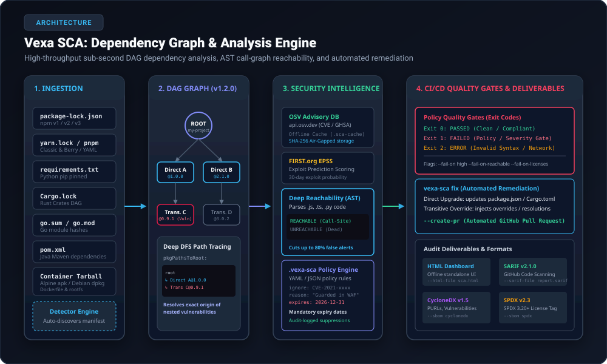
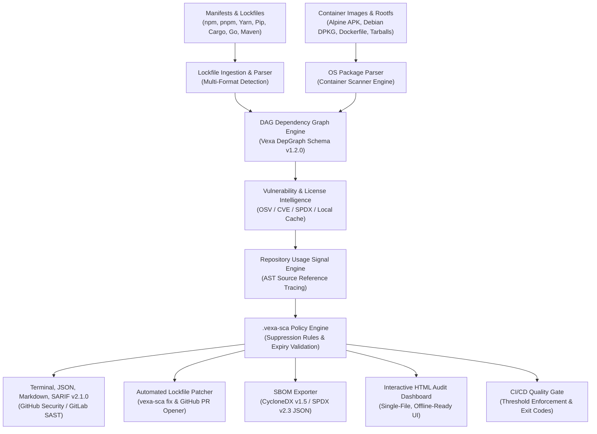

# Vexa SCA: Enterprise-Grade Software Composition Analysis & Security Engine

[](https://github.com/noviqtechnologies/vexa-sca/releases)
[](https://github.com/noviqtechnologies/vexa-sca/actions)
[](#automated-tests--verification)
[](LICENSE)
[](https://www.rust-lang.org/)
[](#cross-platform-installation--setup)
[](SECURITY.md#software-supply-chain--artifact-integrity)
[](#5-software-bill-of-materials-sbom-cyclonedx--spdx)
[](#7-cicd-quality-gates--policy-enforcement)
[](SECURITY.md)
<a href="https://vexasec.io" target="_blank" rel="noopener noreferrer"></a>

**Vexa SCA** (`vexa-sca`) is an open-source, high-performance Software Composition Analysis (SCA) engine built in Rust. Engineered specifically for enterprise DevSecOps pipelines and modern pull-request automation, Vexa SCA delivers ultra-fast, reproducible vulnerability triage, deep transitive dependency graphing, positive-proof verdict integrity, and authoritative CI result surfaces.

<p align="center">
  <a href="#quick-start"><b>Quick Start</b></a> •
  <a href="#multi-ecosystem-coverage--maturity-levels"><b>Support Matrix</b></a> •
  <a href="#-two-operational-profiles-scan-vs-ci"><b>Profiles (Scan vs CI)</b></a> •
  <a href="#-process-exit-code-contract--precedence"><b>Exit Codes</b></a> •
  <a href="docs/open-source-sca.md"><b>Architecture Guide</b></a> •
  <a href="docs/cli-usage.md"><b>CLI Reference</b></a> •
  <a href="docs/cicd-integration.md"><b>CI/CD Pipelines</b></a> •
  <a href="SECURITY.md"><b>Security Policy</b></a>
</p>

---

### ⚡ Highlights & Value at a Glance

*Click any feature to jump directly to its in-depth guide and CLI commands:*

| Key Feature | Security & Developer Value | Quick Command |
| :--- | :--- | :--- |
| 🔍 [**Repository Usage Signals**](#1-repository-usage-signal-analysis) | Classifies dependencies as `IMPORTED_SOURCE`, `REFERENCED_CONFIG_OR_SCRIPT`, or `NO_REFERENCE_FOUND_WITHIN_SCOPE` to highlight top-priority findings without suppressing unverified risks. | `vexa-sca scan` |
| ⚡ [**Pure Rust Core & Cross-Platform**](#cross-platform-installation--setup) | High-throughput multi-threaded analysis with **zero external C / OpenSSL runtime dependencies**. Native single binaries for Linux, macOS & Windows. | `vexa-sca scan` |
| 🔄 [**PR-Differential Scanning**](#pr-differential-scanning---baseline) | Compares PR findings against a baseline report (`--baseline`). Blocks only on newly introduced vulnerabilities while reporting baseline findings as non-blocking. | `vexa-sca scan --baseline base.json --fail-on high` |
| 🤖 [**GitHub Actions Native CI/CD**](#two-operational-profiles-scan-vs-ci) | Generates rich GitHub Job Summaries (`$GITHUB_STEP_SUMMARY`) and annotations that succeed even under restricted read-only tokens (Dependabot/Fork PRs). | `vexa-sca ci --fail-on high` |
| 🚀 [**1-Command Workflow Setup**](#github-actions-initialization-vexa-sca-init) | Bootstrap pinned GitHub Actions CI workflow in `.github/workflows/vexa-sca.yml` with immutable commit SHA action references. | `vexa-sca init --enforce` |
| 🛠️ [**Same-Major Remediation & Fixer**](#2-automated-lockfile-patcher--pr-opener-fix) | Prioritizes non-breaking same-major patch/minor updates over breaking major bumps. Issues `[MAJOR UPGRADE WARNING]` when major jumps are unavoidable. | `vexa-sca fix --create-pr` |
| 📊 [**Standalone Interactive HTML Dashboard**](#6-standalone-interactive-html-audit-dashboard) | Offline-ready single-file HTML report with glassmorphism dark UI, live search/filtering, and finding inspector—**zero external CDNs**. | `vexa-sca scan --html-file sca.html` |
| 📋 [**CycloneDX & SPDX SBOM Generator**](#5-software-bill-of-materials-sbom-cyclonedx--spdx) | Export compliant **CycloneDX v1.5 JSON** (with VEX status) and **SPDX v2.3 JSON** with package URLs (PURLs) and vulnerability metadata. | `vexa-sca scan --sbom cyclonedx` |
| 🛡️ [**Policy-as-Code & Suppression Engine**](#3-policy--suppression-engine-vexa-sca) | Define accepted risks in `.vexa-sca` YAML/JSON with mandatory expiration dates and alias matching (CVE/GHSA/Package). | `vexa-sca scan --policy .vexa-sca` |
| 📈 [**EPSS Exploit Prediction**](#epss-exploit-prediction-likelihood) | Prioritizes CVEs by real-world 30-day exploit likelihood (FIRST.org EPSS) with fail-closed retention during upstream outages. | `vexa-sca scan --epss-threshold 0.50` |
| 🚨 [**CISA KEV Integration**](#9-supply-chain-behavioral-analysis) | Flags CVEs confirmed exploited in the wild via the CISA Known Exploited Vulnerabilities catalog (cached, 24h TTL, +35 priority score boost). | `vexa-sca scan` |
| 🔬 [**Supply Chain Behavioral Analysis**](#9-supply-chain-behavioral-analysis) | 15 static-analysis rules (SC-001–SC-015) detecting typosquatting, CI/CD poisoning, secrets, reverse shells, and MCP prompt-injection in manifests and workflows. | `vexa-sca scan` |
| 🧪 [**Zero-Code-Sync CI SAST & Secret Detection**](#12-zero-code-sync-ci-sast--secret-detection) | Local fast sink analysis (`CWE-78` OS Command Injection, `CWE-89` SQLi, `CWE-94` Eval, `CWE-502` Deserialization, etc.) + redacted Secret Scanning (`AKIA****`) + SARIF v2.1.0 ingestion, working even in lockfile-less repositories. | `npx vexa-sca scan --sast --secrets` |
| 🔥 [**Package Manager Firewall (`wrap`)**](#10-package-manager-firewall-wrap) | Pre-installation zero-shell security gate for npm, pnpm, yarn, bun, pip, uv, and cargo. Blocks typosquatted packages, CISA KEV hits, and OSV advisories before install. | `vexa-sca wrap npm install lodash` |
| 🤖 [**MCP Server (`mcp`)**](#11-mcp-server-integration-mcp) | JSON-RPC 2.0 MCP server exposing 4 tools to AI coding assistants (Cursor, Claude Code, Windsurf, GitHub Copilot). | `vexa-sca mcp` |
| 📤 [**Zero-Code-Retention Facts Export (v2.0)**](#1-vexa-sca-scan) | Generates `.vexa.facts.json` (schema `2.0`) with dependency graph, AST reachability, and stripped SAST/Secret metadata (`file_path`, `line`, `cwe`, canonical `matched_sink` ≤64 chars)—**zero raw source code ever leaves your machine**. | `vexa-sca scan --upload-facts` |
| 🛡️ [**Vexa Cloud 60-Second CI Sync**](#12-zero-code-sync-ci-sast--secret-detection) | Set `VEXA_SCA_SECURITY_API_KEY` in GitHub Actions and run `npx vexa-sca scan` to automatically run Dependency SCA + Code SAST + Secret Detection and stream results to Vexa Cloud (`500 / 500` Free Tier monthly scans). | `VEXA_SCA_SECURITY_API_KEY=vexa_sec_... npx vexa-sca scan` |
| 📦 [**Offline Advisory Bundles (`.vexadb`)**](#12-vexa-sca-db) | Cryptographically verify and use signed offline database bundles via Ed25519 signatures for isolated or air-gapped CI/CD. | `vexa-sca db verify --offline-db bundle.vexadb` |
| 🚦 [**Process Exit Code Contract**](#process-exit-code-contract) | Deterministic automation contract: `0` (clean/pass), `1` (quality gate failure), `2` (config error), `3` (advisory outage / incomplete data). | `vexa-sca ci` |

> [!TIP]
> **Quick Start & Evaluation**:
> 
> Build `vexa-sca` from a reviewed, immutable source revision:
> ```bash
> git clone https://github.com/noviqtechnologies/vexa-sca.git
> cd vexa-sca
> git checkout v1.3.5
> cargo build --locked --release
> ```
> 
> **1. Interactive Visual Scan & Usage Signal Triage**
> ```bash
> # Scan any project and generate a standalone offline HTML audit dashboard:
> target/release/vexa-sca scan --html-file sca-report.html
> ```
> AST Repository Usage Signals reveal which vulnerable packages have direct import/require references (`IMPORTED_SOURCE`) versus unreferenced dependencies within the scanned scope. Signals are heuristic triage aids, do not certify runtime safety, and do not suppress findings from reports.
> 
> **2. Automated Remediation Proposals**
> ```bash
> # Preview proposed fixes without altering files:
> target/release/vexa-sca fix --dry-run
> ```
> `vexa-sca fix` proposes updates prioritizing same-major patch/minor updates. It provides best-effort file restoration of captured root manifests and lockfiles if package-manager regeneration fails, but cannot undo uncaptured filesystem or package-manager side effects.
> 
> *(Evaluating in this cloned repository? Run `cargo run -- scan test/fixtures/npm-app` or `node bin/vexa-sca.js`).*

---

## Table of Contents
- [Quick Start](#quick-start)
- [Cross-Platform Installation & Setup](#cross-platform-installation--setup)
  - [Prerequisites by OS](#prerequisites-by-os)
  - [Building from Source](#building-from-source)
  - [Running the CLI](#running-the-cli)
- [Architecture & Core Concepts](#architecture--core-concepts)
- [Multi-Ecosystem Coverage](#multi-ecosystem-coverage)
- [Key Features](#key-features)
  - [1. Repository Usage Signal Analysis & Verdict Integrity](#1-repository-usage-signal-analysis--verdict-integrity)
  - [2. Automated Lockfile Patcher & PR Opener (`fix`)](#2-automated-lockfile-patcher--pr-opener-fix)
  - [3. Policy & Suppression Engine (`.vexa-sca`)](#3-policy--suppression-engine-vexa-sca)
  - [4. License Compliance Scanner](#4-license-compliance-scanner)
  - [5. Software Bill of Materials (SBOM: CycloneDX & SPDX)](#5-software-bill-of-materials-sbom-cyclonedx--spdx)
  - [6. Standalone Interactive HTML Audit Dashboard](#6-standalone-interactive-html-audit-dashboard)
  - [7. CI/CD Quality Gates & Policy Enforcement](#7-cicd-quality-gates--policy-enforcement)
  - [8. Container & OS Package Scanner (`container`)](#8-container--os-package-scanner-container)
  - [9. Supply Chain Behavioral Analysis](#9-supply-chain-behavioral-analysis)
  - [10. Package Manager Firewall (`wrap`)](#10-package-manager-firewall-wrap)
  - [11. MCP Server Integration (`mcp`)](#11-mcp-server-integration-mcp)
- [CLI Reference](#cli-reference)
  - [`vexa-sca scan`](#1-vexa-sca-scan)
  - [`vexa-sca fix`](#2-vexa-sca-fix)
  - [`vexa-sca licenses`](#3-vexa-sca-licenses)
  - [`vexa-sca graph`](#4-vexa-sca-graph)
  - [`vexa-sca test`](#5-vexa-sca-test)
  - [`vexa-sca container`](#6-vexa-sca-container)
  - [`vexa-sca wrap`](#9-vexa-sca-wrap)
  - [`vexa-sca mcp`](#10-vexa-sca-mcp)
  - [`vexa-sca score`](#11-vexa-sca-score)
  - [`vexa-sca diff`](#12-vexa-sca-diff)
- [Documentation & Workflow Guides](#-documentation--workflow-guides)
  - [🛡️ Open Source SCA Guide (`docs/open-source-sca.md`)](docs/open-source-sca.md)
  - [💻 CLI Usage Guide (`docs/cli-usage.md`)](docs/cli-usage.md)
  - [🚀 CI/CD Integration Guide (`docs/cicd-integration.md`)](docs/cicd-integration.md)
  - [🐳 Container Deployment Guide (`docs/container-deployment.md`)](docs/container-deployment.md)
  - [🪝 Git Hooks Setup Guide (`docs/git-hooks.md`)](docs/git-hooks.md)
  - [Quick Implementation Snippets](#quick-implementation-snippets-by-workflow)
- [Automated Tests & Verification](#automated-tests--verification)
- [License](#license)

---

## Quick Start

### Option 1: Native Rust Binary (Recommended for CI & High Performance)

The native Rust engine has zero external C/runtime dependencies and executes scans with sub-second performance.

#### Linux / macOS
```bash
# Build optimized native release binaries (`vexa-sca`, `vexa`, `sca`)
cargo build --release

# Run scan against current project using primary binary `vexa-sca`
./target/release/vexa-sca scan

# Or run directly via Cargo (default-run is configured to vexa-sca)
cargo run -- scan
```

#### Windows (PowerShell / Command Prompt / Git Bash)
```powershell
# Build optimized native release binaries
cargo build --release

# Run scan against current project (PowerShell / CMD)
.\target\release\vexa-sca.exe scan

# Or run directly via Cargo
cargo run -- scan
```

> [!TIP]
> **Backwards-Compatible Aliases**: Both `vexa` and `sca` are compiled alongside `vexa-sca`. You can invoke `./target/release/vexa-sca scan`, `./target/release/vexa scan`, or `./target/release/sca scan` identically.

---

### Option 2: Run via Node.js / NPX Launcher (All Platforms)

Vexa SCA is built in high-performance Rust. For Node.js environments and JavaScript CI runners, a cross-platform launcher shim (`bin/vexa-sca.js`, with aliases `bin/vexa.js` and `bin/sca.js`) is registered in `package.json`. The shim detects the host OS/architecture and invokes the native compiled engine (`vexa-sca`), falling back to `cargo run` if uncompiled in a development checkout:

```bash
# Using Node.js directly
node bin/vexa-sca.js scan

# Using npm scripts
npm run scan

# Backwards-compatible script invocations
node bin/vexa.js scan
node bin/sca.js scan

# Zero-install execution via npx (invokes native engine)
npx vexa-sca scan
npx vexa scan
```

---

### Option 3: Pre-Built Binary Download (GitHub Releases)

Download pre-compiled standalone binaries with zero installation prerequisites directly from [GitHub Releases](https://github.com/noviqtechnologies/vexa-sca/releases):

```bash
# Linux / macOS (curl download & run)
curl -sSL https://github.com/noviqtechnologies/vexa-sca/releases/latest/download/vexa-sca-linux-x86_64.tar.gz | tar -xz
./vexa-sca scan

# Windows: Download vexa-sca-windows-x86_64.zip, extract, and run vexa-sca.exe
```

---

### Option 4: Run via Docker Container (GitHub Packages / GHCR)

Run scans in any CI/CD runner or containerized environment without installing Rust or Node.js:

```bash
# Pull and scan current directory:
docker run --rm -v "${PWD}:/workspace" ghcr.io/noviqtechnologies/vexa-sca:latest scan .

# Run with reachability analysis and HTML dashboard export:
docker run --rm -v "${PWD}:/workspace" ghcr.io/noviqtechnologies/vexa-sca:latest scan . --reachable-only --html-file sca-report.html
```

---

## Cross-Platform Installation & Setup

Vexa SCA is fully cross-platform and operates identically on **Linux** (x86_64, aarch64, musl/Alpine, glibc), **macOS** (Apple Silicon M1-M4 & Intel), and **Windows** (PowerShell, Command Prompt, Git Bash, WSL).

> [!NOTE]
> **Zero External C / OpenSSL Dependencies**: Vexa SCA uses a pure Rust TLS implementation (`rustls-tls`) and pure Rust decompression (`miniz_oxide`). You do not need to install Perl, OpenSSL dev headers, or build tools solely for cryptographic handshakes or tarball unpacking.

### Quick Install (Verified Precompiled Binaries)

Install Vexa SCA with automatic architecture detection and cryptographic SHA-256 checksum verification:

**Linux / macOS:**
```bash
curl -sSf https://raw.githubusercontent.com/noviqtechnologies/vexa-sca/main/install.sh | sh
```

**Windows (PowerShell):**
```powershell
irm https://raw.githubusercontent.com/noviqtechnologies/vexa-sca/main/install.ps1 | iex
```

**Via Cargo (Rust crates.io / Source):**
```bash
cargo install vexa-sca --locked
```

**Direct GitHub Releases:**
Download prebuilt archives and cosign attestations directly from [GitHub Releases](https://github.com/noviqtechnologies/vexa-sca/releases/latest).

---

### Building from Source

```bash
# Clone the repository at the v1.3.5 release tag
git clone --branch v1.3.5 --depth 1 https://github.com/noviqtechnologies/vexa-sca.git
cd vexa-sca

# Compile release binaries with locked dependencies
cargo build --locked --release
```

Compiled binaries are located at:
- **Linux & macOS**: `target/release/vexa-sca`, `target/release/vexa`, and `target/release/sca`
- **Windows**: `target\release\vexa-sca.exe`, `target\release\vexa.exe`, and `target\release\sca.exe`

### Running the CLI

Install the locally built binary to your user `PATH` using Cargo:
```bash
cargo install --path . --locked

# Now available globally from any terminal or OS:
vexa-sca --help
```

---

## Architecture & Core Concepts

<p align="center">
  
</p>



### Core Architectural Pillars
1. **DAG Dependency Representation**: Modeled after standard dep-graph schema (Schema v1.2.0). Every dependency node is mapped in a Directed Acyclic Graph with distinct `nodeId` and `pkgId` coordinates (`name@version`).
2. **Deep-Path DFS Tracing (`pkgPathsToRoot`)**: Transitive (nested) vulnerabilities trace their exact propagation chains back to the root application.
3. **Repository Usage Signals**: Static AST inspection scans first-party source code to detect whether vulnerable packages have direct import/require references (`IMPORTED_SOURCE`), assisting finding triage without unsafely suppressing unproven risks.
4. **Resilient Local Cache**: Vulnerability lookups are cached on disk (`.sca-cache/`) with SHA-256 hashed keys to minimize repeat network queries (note: `.sca-cache/` is not a complete, signed, indefinitely fresh offline vulnerability database).
5. **Quality Gates & Policy Compliance**: Comprehensive policy evaluation that integrates seamlessly into automated CI/CD pipelines.

---

## Multi-Ecosystem Coverage & Maturity Levels

Vexa SCA automatically identifies project manifests, lockfiles, and container images without manual configuration:

| Ecosystem | Supported Files | Support Tier & Maturity | Detection & Features |
| :--- | :--- | :--- | :--- |
| **Node.js / JavaScript / TypeScript** | `package-lock.json` (v2, v3)<br>`npm-shrinkwrap.json`<br>`pnpm-lock.yaml` (v5, v6, v9) | **Tier 1: GA / Production Ready (P0)** | Full dependency graph, deep-path transitive DFS, AST repository usage signals, same-major remediation with byte-for-byte rollback, SARIF/SBOM exports |
| **Python** | `requirements.txt` | **Tier 2: Experimental / Preview (P2)** | Unpinned requirements preserved as `*` (no guessing), basic lexical import detection |
| **Java** | `pom.xml` | **Tier 2: Experimental / Preview (P2)** | Maven XML coordinate parsing, unresolved versions flagged accurately |
| **Yarn v1** | `yarn.lock` | **Tier 2: Experimental / Preview (P2)** | Yarn v1 lockfile resolution |
| **Go** | `go.sum`, `go.mod` | **Tier 2: Experimental / Preview (P2)** | Go modules dependency tree, version extraction |
| **Rust** | `Cargo.lock` | **Tier 2: Experimental / Preview (P2)** | TOML package blocks, workspace dependency resolution |
| **Container & OS Packages** | Alpine (`apk`), Debian/Ubuntu (`dpkg`), Dockerfile, `.tar`/`.tar.gz` | **Tier 2: Experimental / Preview (P2)** | Distribution auto-detection, OS package vulnerability auditing |

---

## 🚫 What Vexa SCA Does Not Do

To ensure architectural transparency and prevent misleading claims, Vexa SCA establishes strict technical non-goals:

1. **Not a SAST Engine (No Taint Analysis or Cross-File Dataflow)**:
   Vexa SCA is a Software Composition Analysis (SCA) tool, not a Static Application Security Testing (SAST) tool. It analyzes manifests, upstream advisories, and direct import/script references. It does not perform interprocedural control-flow graphs, taint analysis, or dataflow propagation.
2. **No Dynamic / Sandbox Malware Detonation**:
   Vexa SCA audits static dependency coordinates against public vulnerability databases (OSV.dev). It does not execute untrusted package `postinstall` hooks or detonate packages in a microVM or sandbox.
3. **No Automated Exploitability Guarantees**:
   The absence of an observed import statement in scanned first-party files is reported conservatively as `NO_REFERENCE_FOUND_WITHIN_SCOPE` or `UNKNOWN`. It is **never** a certificate of zero risk or non-exploitability (e.g. dynamic reflection, plugin architectures, or CLI invocation vectors).

---

## 🔄 Two Operational Profiles: `scan` vs `ci`

Vexa SCA provides two distinct execution profiles designed for developer ergonomics and deterministic CI/CD automation:

### 1. `vexa-sca scan` (Developer Profile)
Interactive, local developer experience:
- Displays a prominent **First-Result Experience** banner (`PASS`, `FAIL`, `INCOMPLETE`).
- Highlights **Top 3 Priority Recommendations** with 30-second fix rationales and copy-paste remediation commands.
- Never aborts on incomplete data; prints helpful diagnostics and remediation tips.

### 2. `vexa-sca ci` (Automation Profile)
Automated pipeline execution designed for GitHub Actions, GitLab CI, and Bitbucket Pipelines:
- **Fails Closed on Outages**: If the OSV advisory database is unreachable or data is incomplete, exits with code `3` by default to prevent silent false negatives (suppressed with `--allow-unavailable`).
- **PR-Diff Baseline Gating**: With `--baseline <file>`, only newly introduced findings fail the quality gate; pre-existing findings are reported as non-blocking baseline findings.
- **Platform-Native PR Surfaces**: Writes rich Markdown to `$GITHUB_STEP_SUMMARY` and emits workflow annotations (`::error::`, `::warning::`). In restricted-token environments (Dependabot or Fork PRs where PR comment write permissions fail), Job Summaries and exit codes provide direct CI surfaces.

---

## 🚦 Process Exit Code Contract & Precedence

Vexa SCA enforces a strict, unambiguous precedence order across both `scan` and `ci` profiles:

| Precedence | Exit Code | Classification | Description & Conditions | Suppressed by `--no-fail`? |
| :---: | :---: | :--- | :--- | :---: |
| **1st** | **`2`** | **Configuration / Argument Error** | Invalid command-line arguments, conflicting flags, invalid or expired `.vexa-sca` policy file, missing mandatory audit fields (`reason`, `owner`, `ticket`, `expires`). **Rejects execution before scanning begins.** | **No** (never suppressed) |
| **2nd** | **`3`** | **Incomplete Requested Scan Data** | Unparseable/corrupted manifest, analysis limits exceeded (e.g., 500-source-file cap hit), upstream advisory lookup failure without usable cache, or report file generation/write failure. **Takes precedence over a simultaneous quality gate failure.** Findings and severity gate status are still recorded in reports and summaries. | **No** (never suppressed; `--allow-unavailable` waives advisory outages only, never manifest, source-limit, or write failures) |
| **3rd** | **`1`** | **Quality Gate Failure** | Complete scan finished, but detected vulnerabilities or license policies violate configured thresholds (`--fail-on <severity>`, `--fail-on-reachable`, or license limits). | **Yes** (converted to `0` for report-only automation) |
| **4th** | **`0`** | **Success / Clean** | Complete scan finished and all configured quality gates passed with no policy violations. | N/A |

---

## 🤖 GitHub Actions Workflow Initialization (`vexa-sca init`)

Set up a hardened, pinned GitHub Actions CI workflow in 1 command:

```bash
# Initialize non-blocking report workflow in .github/workflows/vexa-sca.yml
vexa-sca init

# Or enforce quality gate (fails on high/critical vulnerabilities)
vexa-sca init --enforce
```

This generates `.github/workflows/vexa-sca.yml` pinned to immutable commit SHAs (`actions/checkout@11bd71901bbe5b1630ceea73d27597364c9af683`) for supply chain security.

> [!TIP]
> **Ready-to-use Workflow Configurations**: See [docs/cicd-integration.md](docs/cicd-integration.md#complete-github-actions-workflow-githubworkflowsvexa-scayml) for complete copy-pasteable GitHub Actions (`.github/workflows/vexa-sca.yml`) and GitLab CI (`.gitlab-ci.yml`) pipeline definitions with SARIF and SBOM archiving.

---

## Key Features

### 1. Repository Usage Signal Analysis & Verdict Integrity

Standard SCA tools flag every dependency in a tree equally, creating alert fatigue. Conversely, prematurely declaring vulnerabilities "unreachable" without proof creates dangerous blind spots.

Vexa SCA replaces binary reachability assumptions with **Repository Usage Signals** and strict **Positive Proof Rules**:

- **Repository Usage Classification**:
  - `IMPORTED_SOURCE`: The package is directly imported or required in first-party JavaScript, TypeScript, Python, Rust, or Go code.
  - `REFERENCED_CONFIG_OR_SCRIPT`: The package is referenced in `package.json` scripts (`build`, `test`), `bin` entries, or tool configurations.
  - `NO_REFERENCE_FOUND_WITHIN_SCOPE`: No direct lexical reference was found within scanned source files (scans up to 10,000 files by default).
  - `UNKNOWN`: Symbol data is unavailable, the finding resides on a transitive dependency not directly referenced, or AST coverage could not be completed.
  - `UNREACHABLE` *(v2.0)*: **Positive-proof absence**: the workspace index was fully built, no file-limit or parse-failure guard tripped, and no import or call site for the vulnerable symbol was found across all source files. This is a strict no-false-safe verdict — dynamic constructs, barrel re-exports, and transitive chains block this classification.
- **Positive Proof Rule**: A finding is **never** certified as `UNREACHABLE` unless all guards are cleared. If symbol metadata is absent, a dependency is transitive, the file limit was hit, any parse failed, or an unresolved dynamic import exists, the finding remains `UNKNOWN` with an explicit reason code (`NO_SYMBOL_DATA`, `TRANSITIVE_NOT_ANALYZED`, `FILE_LIMIT_HIT`, `PARSE_FAILURE`, `DYNAMIC_IMPORT`).
- **Single-Pass `WorkspaceAstIndex` *(v2.0)***: All source files are indexed once at engine startup across JS/TS (via `oxc` AST), Python, Rust, Go, and Java — eliminating the O(F×V) re-parse overhead from v1.x. Non-JS files are analyzed with language-appropriate regex analyzers, never fed to `oxc_parser`.
- **Multi-Language Call-Site Detection *(v2.0)***: Rust `use crate::pkg::fn;` imports followed by direct `fn(...)` calls, Python `import pkg as alias; alias.fn()` patterns, and JS/TS ESM/CJS/dynamic-import chains are all resolved through the same index.
- **Priority Scoring**: Findings are ranked by a deterministic 10-point priority score combining CVSS severity, usage signal, EPSS exploit likelihood, and direct vs transitive depth.

```bash
# Run scan with repository usage ranking
vexa-sca scan
```

---

### 2. Automated Lockfile Remediation Proposals (`fix`)

Propose dependency updates to remediate vulnerabilities:
- **Same-Major Upgrade Preference**: Prioritizes non-breaking patch and minor version bumps within the current major version series (e.g. upgrading `1.0.4` to `1.0.5` rather than jumping to breaking `2.0.0`).
- **Major Upgrade Warnings**: When only a major version resolves an advisory, Vexa SCA highlights `[MAJOR UPGRADE WARNING]` indicating potential API breaking changes.
- **Transitive Remediation Advice**: For nested dependencies, provides manager-specific overrides (`overrides` in npm, `pnpm.overrides` in pnpm, `resolutions` in Yarn).
- **Best-Effort File Restoration**: On failed lockfile regeneration, attempts to restore captured root manifests and lockfiles (`package.json`, `package-lock.json`, `pnpm-lock.yaml`, `yarn.lock`). Note that package-manager side effects (e.g. modified `node_modules`, registry caches, or uncaptured files) are outside this boundary. Review all changes before committing.

```bash
# Preview proposed fixes without altering files
vexa-sca fix --dry-run

# Apply fixes locally with same-major preference
vexa-sca fix

# Automatically open a GitHub Pull Request
vexa-sca fix --create-pr --repo owner/my-repo --token $GITHUB_TOKEN
```

---

### 3. Policy & Suppression Engine (`.vexa-sca`)

Manage audited risks, temporary waivers, and grace periods with strict schema enforcement (`deny_unknown_fields`). Misspelled fields, missing audit information, or expired dates cause scans to fail immediately with exit code `2`.
- **Mandatory Audit Fields**: Every rule requires `id`, `package`, non-empty `reason`, `owner` (email or team handle), `ticket` (issue reference), and `expires` (`YYYY-MM-DD`).
- **Maximum Waiver Lifetime**: Governed by `max_waiver_days` (default: 90 days; configurable up to organizational limits).
- **Exact & Alias Matching**: Suppresses findings across matched advisory aliases (CVE, GHSA, or Package ID).

#### Example `.vexa-sca` (YAML):
```yaml
version: "v1.0.0"
max_waiver_days: 90

ignore:
  - id: "GHSA-35jh-r3h4-6jhm"
    package: "lodash"
    reason: "Prototype pollution input vector sanitized by ingress API schema validation"
    owner: "sec-team@example.com"
    ticket: "SEC-1042"
    created: "2026-10-01"
    expires: "2026-12-15"

  - id: "CVE-2021-23337"
    package: "lodash"
    reason: "Internal CLI utility only; service is strictly air-gapped without remote inputs"
    owner: "platform@example.com"
    ticket: "INFRA-501"
    created: "2026-10-15"
    expires: "2026-11-30"
```

#### Example `.vexa-sca.json` (JSON):
```json
{
  "version": "v1.0.0",
  "max_waiver_days": 90,
  "ignore": [
    {
      "id": "GHSA-35jh-r3h4-6jhm",
      "package": "lodash",
      "reason": "Prototype pollution input vector sanitized by ingress API schema validation",
      "owner": "sec-team@example.com",
      "ticket": "SEC-1042",
      "created": "2026-10-01",
      "expires": "2026-12-15"
    }
  ]
}
```

---

### 4. License Compliance Scanner

Categorize dependencies by open source license metadata and intellectual property risk categories:
- **Permissive**: MIT, Apache-2.0, BSD-2/3-Clause, ISC, CC0, Unlicense.
- **Weak Copyleft**: LGPL-2.1/3.0, MPL-2.0, EPL-1.0/2.0, CDDL.
- **Strong Copyleft**: GPL-2.0/3.0, AGPL-3.0, SSPL, EUPL.

> [!NOTE]
> **Metadata Resolution & Legal Disclaimer**: License discovery extracts declared license identifiers from manifests, lockfiles, and local package files. When license fields are absent or unresolved, packages are categorized as `UNKNOWN`. This scanner surfaces detected metadata only and does not provide legal advice or certify commercial distribution safety.

```bash
vexa-sca licenses ./my-project
```

---

### 5. Software Bill of Materials (SBOM: CycloneDX & SPDX)

Generate industry-standard Software Bill of Materials compliant with executive cybersecurity orders and enterprise procurement standards:

- **CycloneDX v1.5 JSON**: Standardized components with Package URLs (`pkg:npm/lodash@4.17.15`), licenses, transitive dependency trees, and integrated vulnerability records with severity ratings and advisory URLs.
- **SPDX v2.3 JSON**: Official Linux Foundation SPDX document structure with packages, SPDX license identifiers, download locations, verification checksums, and `DEPENDS_ON` relationship graphs.

```bash
# Output CycloneDX v1.5 JSON to stdout
vexa-sca scan --sbom cyclonedx

# Export CycloneDX SBOM directly to file
vexa-sca scan --sbom cyclonedx --sbom-file sbom-cyclonedx.json

# Export SPDX v2.3 JSON directly to file
vexa-sca scan --sbom spdx --sbom-file sbom-spdx.json
```

---

### 6. Standalone Interactive HTML Audit Dashboard

Generate a modern, self-contained, offline-ready HTML security report:
- **Zero External CDNs**: All CSS styles and interactivity are embedded directly in a single HTML file—perfect for air-gapped CI/CD artifacts and compliance audits.
- **Glassmorphism Dark Theme**: Sleek UI with KPI metrics cards, severity distribution progress bars, and high-contrast status tags.
- **Client-Side Live Filtering & Search**: Instant real-time search across packages, CVEs, and summaries, with filter tabs for `All`, `Critical`, `High`, `Reachable`, and `License Risk`.
- **Deep Call-Site Inspector**: Expandable vulnerability cards displaying call-graph AST traces, vulnerable function references, and reproduction snippets.

```bash
# Generate single-file interactive HTML dashboard
vexa-sca scan --html-file sca-report.html

# Stream HTML directly to standard output
vexa-sca scan --html > report.html
```

---

### 7. CI/CD Quality Gates & Policy Enforcement

Automate pass/fail gates in build pipelines with customizable failure conditions and deterministic exit codes.

#### Exit Code Contract & Precedence:
- **`2` (Config / Arg Error)**: Invalid arguments, malformed policy, expired waivers. Rejected before scanning.
- **`3` (Incomplete Data)**: Advisory lookup failure, file cap hit, manifest parse error, or report-write failure. Takes precedence over gate failure.
- **`1` (Quality Gate Failure)**: Complete scan finished, but findings exceed configured threshold (`--fail-on <severity>`, `--fail-on-reachable`, or license limits). Suppressed by `--no-fail`.
- **`0` (Success)**: Complete scan finished with zero gate violations.

- `--fail-on <low|medium|high|critical>`: Block builds when vulnerabilities equal or exceed the given severity.
- `--fail-on-reachable`: Break builds only if a vulnerability has verified AST call-graph reachability.
- `--fail-on-licenses <copyleft|weak-copyleft|unapproved>`: Fail if non-compliant copyleft or unapproved licenses are present in the dependency tree.
- `--no-fail` / `--report-only`: Always exit 0 even if security vulnerabilities are found (useful for report-generating cron jobs).

```bash
# Default Secure CI Behavior: generates results.json, exits 1 if findings exist
vexa-sca scan --json > results.json

# Report-Only Generation: generates results.json and always exits 0
vexa-sca scan --json --no-fail > results.json

# Fail CI build if any critical vulnerability is found
vexa-sca scan --fail-on critical

# Fail CI build only if an exploitable (reachable) vulnerability exists
vexa-sca scan --fail-on-reachable

# Enforce open source compliance: block viral copyleft licenses (GPL, AGPL)
vexa-sca scan --fail-on-licenses copyleft

# Combine gates for zero-tolerance security
vexa-sca scan --fail-on high --fail-on-reachable --fail-on-licenses copyleft
```

When a gate fails, Vexa SCA prints a detailed colored terminal banner listing every triggering policy violation:
```text
======================================================================
 [QUALITY GATE FAILED] Policy Violations Detected (1)
======================================================================
  [FAIL] 1 critical vulnerabilities found (threshold: critical)
  [FAIL] 1 verified reachable vulnerabilities found
======================================================================
```

---

### 8. Container & OS Package Scanner (`container`)

Inspect containerized environments and operating system packages for Linux CVEs:
- **Alpine Linux**: Parses `/lib/apk/db/installed` package database and version coordinates.
- **Debian / Ubuntu**: Parses `/var/lib/dpkg/status` package metadata and architectures.
- **Distribution Auto-Detection**: Reads `/etc/os-release` or `/usr/lib/os-release` to resolve OS names, versions, and codenames (e.g. Alpine 3.18, Ubuntu 22.04 LTS).
- **Tarball Archive Inspection**: Scans uncompressed `.tar` and gzip-compressed `.tar.gz` / `.tgz` container image layers without requiring Docker or root privileges.
- **Dockerfile Base Analysis**: Extracts base image declarations (`FROM alpine:3.18`, `FROM node:18-bullseye`).

```bash
# Scan an extracted container rootfs or sysroot
vexa-sca container /path/to/container/rootfs

# Scan an exported Docker image archive
docker save my-app:latest -o my-app.tar
vexa-sca container my-app.tar

# Output container scan as structured JSON or SARIF
vexa-sca container my-app.tar --json
vexa-sca container my-app.tar --sarif-file container-sarif.json

# Enforce quality gates on container scanning
vexa-sca container /var/chroot/alpine --fail-on high
```

---

### 9. Supply Chain Behavioral Analysis

Vexa SCA v2.0 includes a **static supply chain behavioral analyzer** that scans manifests, GitHub Actions workflows, MCP configuration files, and source code for 15 classes of supply chain attack patterns — with no runtime execution required.

**Supply Chain Rules (SC-001 – SC-015):**

| Rule | Signal Name | Severity | What It Detects |
| :--- | :--- | :--- | :--- |
| SC-001 | `install_script_execution` | 🔴 High | `preinstall` / `install` / `postinstall` lifecycle scripts in `package.json`; `cmdclass` overrides in `setup.py` |
| SC-002 | `install_script_network_egress` | 🔴 Critical | Install hooks that initiate network egress (`curl`, `wget`, `fetch()`, `Invoke-WebRequest`, `net.connect`) |
| SC-003 | `dynamic_code_eval` | 🔴 High | Dynamic code evaluation: `eval()`, `new Function()`, `vm.runInNewContext()`, `exec(b64decode(...))` |
| SC-004 | `child_process_shell` | 🔴 High | Child process spawned with shell interpolation: `child_process.exec/execSync`, `subprocess.Popen(shell=True)`, `os.system()` |
| SC-005 | `high_entropy_obfuscation` | 🔴 High | String literals > 256 bytes with Shannon entropy > 5.85 bits/byte and obfuscation markers (`_0x`, `Buffer.from`, `base64`, `atob`) |
| SC-006 | `env_credential_harvesting` | 🔴 Critical | Module reads secret env vars (`AWS_SECRET`, `GITHUB_TOKEN`, `OPENAI_API_KEY`, etc.) while also importing network socket primitives |
| SC-007 | `sensitive_filesystem_access` | 🔴 Critical | Reads host credential files: `.ssh/id_rsa`, `.aws/credentials`, `.kube/config`, `/etc/shadow`, `/proc/self/mem` |
| SC-008 | `trojan_source_bidi` | 🔴 Critical | Unicode Bidirectional Override characters (U+202A–U+202E, U+2066–U+2069) in source files (CVE-2021-42574) |
| SC-009 | `unpinned_git_or_http_tarball` | 🟠 Medium | Lockfile dependency resolves from unpinned `git+ssh://`, `git+https://`, or plain `http://` URL (non-registry source) |
| SC-010 | `typosquat_top_10k` | 🔴 High | Package name within Damerau-Levenshtein edit distance ≤ 1 from a curated popular-package list (e.g. `loadsh` → `lodash`) |
| SC-011 | `native_addon_binary_blob` | 🟠 Medium | Repository contains precompiled native binary blobs: `.node`, `.dylib`, `.so`, `.dll`, `.exe` files |
| SC-012 | `crypto_miner_stratum` | 🔴 Critical | Cryptocurrency miner signatures: `stratum+tcp://`, `stratum+ssl://`, `xmrig`, `cryptonight` |
| SC-013 | `reverse_shell_signature` | 🔴 Critical | Reverse shell patterns: `/bin/bash -i`, `bash -i >& /dev/tcp/`, `nc -e`, `sh -i >& /dev/tcp/`, `pty.spawn('/bin/bash')` |
| SC-014 | `github_actions_unpinned_ref` | 🔴 High | GitHub Actions `uses:` references not pinned to immutable 40-hex-char commit SHA (e.g. `@v2`, `@main`, `@latest`); dangerous `pull_request_target` + head checkout |
| SC-015 | `mcp_unsafe_tool_config` | 🔴 High | MCP server config executes `npx -y <unpinned-pkg>`, or grants unrestricted host filesystem root (`/`, `C:\`) |

```bash
# Supply chain analysis runs automatically during a normal scan
vexa-sca scan

# Output supply chain findings as JSON
vexa-sca scan --json | jq '.supply_chain_findings'
```

---

### 10. Package Manager Firewall (`wrap`)

See [`vexa-sca wrap`](#9-vexa-sca-wrap) in the CLI Reference for full details and examples.

---

### 11. MCP Server Integration (`mcp`)

See [`vexa-sca mcp`](#10-vexa-sca-mcp) in the CLI Reference for full details and client configuration.

---

## CLI Reference

All commands support relative and absolute paths, cross-platform path separators (`/` or `\`), and default to the current working directory (`.`). You can use `vexa-sca`, `vexa`, or `sca` interchangeably.

### 1. `vexa-sca scan`
Scan project dependencies for known security vulnerabilities (Developer interactive profile).

```bash
vexa-sca scan [PATH] [OPTIONS]
```

| Flag | Type | Description |
| :--- | :--- | :--- |
| `[PATH]` | Argument | Target directory to scan (defaults to `.`) |
| `--baseline <FILE>` | Option | Baseline report (JSON or SARIF) for PR-differential gating |
| `--reachable-only` | Flag | Only show vulnerabilities with confirmed source usage signals |
| `--prod-only` | Flag | Exclude development dependencies (`devDependencies`) |
| `--policy <FILE>` | Option | Path to custom policy file (`.vexa-sca` or `.vexa-sca.json`) |
| `--severity-threshold <LVL>` | Option | Minimum severity to report: `low`, `medium`, `high`, `critical` |
| `--ignore-unfixed` | Flag | Only show vulnerabilities with known fixed remediation versions |
| `--json` | Flag | Output structured JSON report to standard output |
| `--markdown` | Flag | Output formatted Markdown report to standard output |
| `--sarif` | Flag | Output OASIS SARIF v2.1.0 report to standard output |
| `--sarif-file <PATH>` | Option | Write SARIF v2.1.0 report directly to a file |
| `--html` | Flag | Output standalone interactive HTML dashboard to standard output |
| `--html-file <PATH>` | Option | Write standalone interactive HTML dashboard to a file |
| `--sbom <FORMAT>` | Option | Output SBOM in `cyclonedx` (v1.5) or `spdx` (v2.3) JSON format |
| `--sbom-file <PATH>` | Option | Write SBOM report directly to a file |
| `--fail-on <LVL>` | Option | Fail scan with exit code 1 if vulnerabilities meet/exceed severity |
| `--fail-on-reachable` | Flag | Fail scan with exit code 1 if any vulnerability has direct source usage |
| `--fail-on-licenses <CAT>` | Option | Fail scan with exit code 1 on license risk (`copyleft`, `weak-copyleft`) |
| `--no-fail`, `--report-only` | Flag | Exit with code 0 even when security vulnerabilities are detected |
| `--epss-threshold <FLOAT>` | Option | Filter vulnerabilities by minimum EPSS probability (0.0 to 1.0) |
| `--allow-unavailable` | Flag | Allow scan to succeed (exit 0) even if OSV database is unreachable |
| `--usage` | Flag | Display open engine license and scan status |
| `--upload-facts` | Flag | Generate `.vexa.facts.json` Zero-Code-Retention workspace facts file (dependency graph + import facts) for team upload |

---

### 2. `vexa-sca ci`
Automated scan profile designed for CI/CD pipelines (GitHub Actions, GitLab, Bitbucket).

Fails closed by default with exit code `3` if the OSV vulnerability database is unreachable, and exit code `1` if the quality gate fails. Automatically populates GitHub Job Summaries and workflow annotations.

```bash
vexa-sca ci [PATH] [OPTIONS]
```

| Flag | Type | Description |
| :--- | :--- | :--- |
| `[PATH]` | Argument | Target directory to scan (defaults to `.`) |
| `--baseline <FILE>` | Option | Baseline report (JSON or SARIF) for PR-differential gating |
| `--job-summary-file <FILE>` | Option | Path to write GitHub Job Summary markdown (defaults to `$GITHUB_STEP_SUMMARY`) |
| `--sarif-file <FILE>` | Option | Save standard OASIS SARIF v2.1.0 report to a file path (for GitHub Code Scanning) |
| `--sbom <FORMAT>` | Option | Output Software Bill of Materials (`cyclonedx` or `spdx`) |
| `--sbom-file <FILE>` | Option | Save SBOM report to a file path |
| `--json` | Flag | Output report in JSON format |
| `--markdown` | Flag | Output report in Markdown format |
| `--fail-on <LVL>` | Option | Fail CI build with exit code 1 if vulnerabilities meet or exceed severity (`low`, `medium`, `high`, `critical`) |
| `--fail-on-licenses <CAT>` | Option | Fail CI build with exit code 1 on license risk category |
| `--allow-unavailable` | Flag | Escape hatch: exit 0 even if the advisory database is unreachable |
| `--no-fail` | Flag | Non-blocking report mode (suppresses exit code 1 on findings) |

---

### 3. `vexa-sca init`
Bootstrap a hardened, pinned GitHub Actions workflow and `.vexa-sca` policy file for Vexa SCA.

```bash
# Generate non-blocking CI workflow in .github/workflows/vexa-sca.yml and .vexa-sca policy template
vexa-sca init [PATH]

# Generate blocking CI workflow (fails on high/critical vulnerabilities)
vexa-sca init [PATH] --enforce
```

---

### 4. `vexa-sca fix`
Automatically remediate vulnerabilities in manifest dependencies and lockfiles.

```bash
vexa-sca fix [PATH] [OPTIONS]
```

| Flag | Type | Description |
| :--- | :--- | :--- |
| `[PATH]` | Argument | Target directory (defaults to `.`) |
| `--dry-run` | Flag | Preview changes and PR details without modifying files |
| `--create-pr` | Flag | Create git branch, commit changes, and open a GitHub PR |
| `--repo <OWNER/REPO>` | Option | Target GitHub repository (e.g. `acme/backend`) |
| `--token <TOKEN>` | Option | GitHub token (defaults to `GITHUB_TOKEN` or `GH_TOKEN` env) |
| `--branch <NAME>` | Option | Custom branch name for security fix PR |
| `--base <NAME>` | Option | Base branch to target (defaults to repo default branch) |

---

### 5. `vexa-sca licenses`
Audit licenses across the entire dependency graph.

```bash
vexa-sca licenses [PATH]
```

| Flag | Type | Description |
| :--- | :--- | :--- |
| `[PATH]` | Argument | Target directory (defaults to `.`) |

---

### 6. `vexa-sca graph`
Inspect and visualize the dependency graph representation.

```bash
# Print visual DAG hierarchy
vexa-sca graph

# Export JSON schema v1.2.0 dependency graph
vexa-sca graph --json
```

---

### 7. `vexa-sca test`
Perform an ad-hoc query on an individual package version without needing a lockfile.

```bash
vexa-sca test <PACKAGE@VERSION> [ECOSYSTEM]
```

Supported ecosystems: `npm` (default), `PyPI`, `Go`, `crates.io`, `Maven`.

```bash
vexa-sca test lodash@4.17.15 npm
vexa-sca test flask@0.12.2 PyPI
vexa-sca test org.apache.logging.log4j:log4j-core@2.14.1 Maven
```

---

### 8. `vexa-sca container`
Scan container images, exported root filesystems, and Dockerfiles for OS package vulnerabilities.

```bash
vexa-sca container [TARGET] [OPTIONS]
```

| Flag | Type | Description |
| :--- | :--- | :--- |
| `[TARGET]` | Argument | Path to rootfs directory, `.tar` / `.tar.gz` image, or Dockerfile (defaults to `.`) |
| `--severity-threshold <LVL>` | Option | Minimum severity to report: `low`, `medium`, `high`, `critical` |
| `--json` | Flag | Output structured JSON report to standard output |
| `--markdown` | Flag | Output formatted Markdown report to standard output |
| `--sarif` | Flag | Output OASIS SARIF v2.1.0 report to standard output |
| `--sarif-file <PATH>` | Option | Write SARIF v2.1.0 report directly to a file |
| `--html` | Flag | Output standalone interactive HTML dashboard to standard output |
| `--html-file <PATH>` | Option | Write standalone interactive HTML dashboard to a file |
| `--sbom <FORMAT>` | Option | Output SBOM in `cyclonedx` (v1.5) or `spdx` (v2.3) JSON format |
| `--sbom-file <PATH>` | Option | Write SBOM report directly to a file |
| `--fail-on <LVL>` | Option | Fail scan with exit code 1 if OS package vulnerabilities meet/exceed severity |
| `--fail-on-licenses <CAT>` | Option | Fail scan with exit code 1 on license risk category |

**Examples:**
```bash
# Scan an extracted Alpine or Debian container rootfs
vexa-sca container /path/to/rootfs

# Scan an exported Docker image archive and export SARIF
vexa-sca container my-image.tar --sarif-file container.sarif

# Output container scan as structured JSON
vexa-sca container my-image.tar.gz --json

# Enforce CI quality gate on container images
vexa-sca container /path/to/rootfs --fail-on high
```

---

### 7. `vexa-sca usage`
Display active plan tier and scan quota volume. In the **Free Developer Edition**, local CLI tests and open-source repository scans are **100% unlimited**:

```bash
# Display human-readable quota and usage box
vexa-sca usage

# Output structured JSON for automation or dashboards
vexa-sca usage --json
```

---

### 9. `vexa-sca wrap`
Pre-installation package manager firewall with zero-shell command execution. Intercepts package installations and evaluates each requested package for typosquatting, CISA KEV exposure, and OSV advisories **before** the install runs.

```bash
vexa-sca wrap <PACKAGE_MANAGER> [ARGS...]
```

Supported package managers: `npm`, `pnpm`, `yarn`, `bun`, `pip`, `uv`, `cargo`.

**Examples:**
```bash
# Intercept npm install and scan all requested packages
vexa-sca wrap npm install express lodash

# Intercept pnpm add and block any typosquatted or KEV-flagged packages
vexa-sca wrap pnpm add react

# Intercept cargo add
vexa-sca wrap cargo add serde tokio

# Intercept pip install (Team+ mode requires VEXA_SCA_API_KEY)
vexa-sca wrap pip install flask requests
```

**What the firewall checks:**
| Check | Rule | Action on Fail |
| :--- | :--- | :--- |
| Typosquatting detection | SC-010 — Damerau-Levenshtein distance ≤1 across 250+ popular packages (npm, PyPI, crates.io, Go, Maven) | Exit code 1, print `[FIREWALL BLOCKED]` |
| Pre-flight Manifest & Lifecycle Scripts | Remote registry manifest inspection for preinstall/postinstall lifecycle scripts executing `curl`, `wget`, `powershell`, `Invoke-WebRequest`, reverse shells (`nc -e`, `sh -i`, `bash -i >& /dev/tcp`), or obfuscated `eval()` | Exit code 1, print `[FIREWALL BLOCKED] Malicious Lifecycle Script` |
| CISA KEV exposure | Any requested package version has a KEV-listed CVE | Exit code 1, print KEV CVE and date added |
| OSV advisory scan | Any requested package has a published OSV advisory | Exit code 1, print advisory summary |

> [!IMPORTANT]
> `vexa-sca wrap` uses `std::process::Command` with array arguments — **zero shell interpolation** across Windows, Linux, and macOS. The original package manager command runs only when all security checks pass (exit code 0). In Team+ mode, authenticated scans use `VEXA_SCA_API_KEY`.

---

### 10. `vexa-sca mcp`
Start a **Model Context Protocol (MCP)** JSON-RPC 2.0 server over `stdin`/`stdout`. Exposes Vexa SCA security tools to AI coding assistants including **Cursor**, **Claude Code**, **Windsurf**, and **GitHub Copilot**.

```bash
vexa-sca mcp
```

**Available MCP tools:**
| Tool | Description |
| :--- | :--- |
| `vexa_check_package` | Check a single package name + version for vulnerabilities, CISA KEV status, and supply chain risks |
| `vexa_scan_workspace` | Scan an entire workspace directory and return structured findings |
| `vexa_explain_finding` | Explain a vulnerability finding or supply chain rule in plain English |
| `vexa_remediate_manifest` | Propose a remediated version for a vulnerable dependency in a manifest |

**MCP client configuration** (e.g. Cursor `mcp.json`):
```json
{
  "mcpServers": {
    "vexa-sca": {
      "command": "vexa-sca",
      "args": ["mcp"]
    }
  }
}
```

> [!NOTE]
> The MCP server uses blocking `stdin`/`stdout` JSON-RPC 2.0 framing (one JSON object per line). It does not require network access or cloud credentials for the open-source tier.

---

### 11. `vexa-sca score`
Evaluate any open-source package or workspace target across 4 holistic security and maintenance pillars: **Supply Chain Risk**, **Vulnerability Posture**, **Maintenance Cadence**, and **License Compliance**. Emits a composite score (0-100) and grade (`A+`, `A`, `B`, `C`, `F`).

```bash
vexa-sca score <TARGET> [--eco <ECOSYSTEM>] [--json]
```

**Examples:**
```bash
# Evaluate npm package health
vexa-sca score express --eco npm

# Evaluate PyPI package health
vexa-sca score requests --eco pypi

# Evaluate local workspace directory
vexa-sca score .

# Output machine-readable JSON
vexa-sca score lodash --eco npm --json
```

**Sample Output:**
```
================================================================================
  Vexa SCA Package Health & Security Score
================================================================================
  Package:        express
  Ecosystem:      npm
  Composite:      94/100
  Grade:          A

  Pillars:
    - Supply Chain:   100%
    - Vulnerability:  90%
    - Maintenance:    95%
    - License:        90%

  Key Insights:
    * Passed typosquatting checks against 250+ top registry packages.
    * No known CISA KEV or critical OSV advisories detected.
================================================================================
```

---

### 12. `vexa-sca diff`
Compare dependencies between two lockfiles (`<BASE_LOCKFILE>` vs `<HEAD_LOCKFILE>`) or commits. Detects removed, bumped, and newly added packages, highlighting **Capability Escalation & Supply Chain Warnings** on new additions.

```bash
vexa-sca diff <BASE_LOCKFILE> <HEAD_LOCKFILE>
```

**Examples:**
```bash
# Compare main branch lockfile vs PR lockfile
vexa-sca diff base-package-lock.json head-package-lock.json

# Diff Cargo.lock files
vexa-sca diff base-Cargo.lock Cargo.lock
```

Outputs newly introduced dependencies, version changes, and warns if added dependencies match typosquatting patterns or contain sensitive network egress capabilities.

---

### 11. `vexa-sca auth` (Vexa SCA Dashboard Authentication)

Authenticate your local environment or CI runner with the Vexa SCA control plane:

```bash
# Log in interactively with a Personal Access Token (starts with vexa_pat_...)
vexa-sca auth login --token vexa_pat_live_0123456789abcdef0123456789abcdef

# Check current active authentication status and organization tier
vexa-sca auth status

# Log out and erase stored credentials from ~/.vexa/credentials.json
vexa-sca auth logout
```

Once logged in, scan facts can be streamed to the Vexa SCA posture dashboard with zero source code exposure:
```bash
vexa-sca scan . --upload
```

---

### 12. `vexa-sca db` (Offline Database Verification)

Cryptographically verify offline vulnerability database bundles (`.vexadb`) signed with Ed25519:

```bash
# Verify bundle integrity and cryptographic signature before scanning
vexa-sca db verify --offline-db /var/vexa/bundles/production-2026.11.01.vexadb

# Scan using the verified offline database (no network requests required)
vexa-sca scan . --offline-db /var/vexa/bundles/production-2026.11.01.vexadb
```

---

### 13. Official GitHub Action (`noviqtechnologies/vexa-sca`)

Automate Vexa SCA in any GitHub repository using the official composite action:

```yaml
name: Vexa SCA Security Scan

on:
  push:
    branches: [main]
  pull_request:
    branches: [main]

permissions:
  contents: read
  security-events: write

jobs:
  security:
    runs-on: ubuntu-latest
    steps:
      - uses: actions/checkout@v4
      - name: Run Vexa SCA
        uses: noviqtechnologies/vexa-sca@v1
        with:
          token: ${{ secrets.VEXA_SCA_SECURITY_API_KEY }}
          fail-on: "high"
          sarif-file: "results.sarif"
          upload-sarif: "true"
```

---

## 📈 EPSS & Multi-Source Exploit Weaponization Intelligence

Standard CVSS scores reflect theoretical severity, not whether attackers are actively weaponizing a vulnerability in the wild. Vexa SCA synthesizes multi-layer threat intelligence directly into local scan results and pull request gates:

1. **Google OSV & GHSA:** Maps dependency coordinates to CVE/GHSA IDs, patched versions, and CWE classifications.
2. **NVD / CVSS v3.1:** Authoritative severity vectors and base metrics.
3. **FIRST.org EPSS:** Batched 30-day statistical exploit prediction probabilities.
4. **CISA KEV & Public PoC Tracking:** Flags vulnerabilities actively targeted in ransomware/campaigns (CISA KEV) and verifies whether functional exploit scripts exist on Exploit-DB, Packet Storm, or public PoC registries.

```bash
# Prioritize vulnerabilities with a 20%+ probability of real-world exploitation
vexa-sca scan --epss-threshold 0.20

# Filter by high EPSS exploit probability alongside usage signal triage
vexa-sca scan --epss-threshold 0.50
```

---

## 🛡️ Privacy, Network Egress & Local Execution Policy

Vexa SCA operates as a standalone CLI tool without cloud accounts, billing tiers, or proprietary telemetry:
* **Package Coordinate Disclosure**: Advisory enrichment queries the public OSV API (`api.osv.dev`) over HTTPS. Queries disclose package coordinates (`ecosystem`, `name`, `version`). No first-party source code, file paths, git metadata, or proprietary package contents are ever transmitted.
* **Local Cache**: Advisory responses are cached locally on disk in `.sca-cache/` to reduce repeat lookups during development and CI. `.sca-cache/` is not a complete, signed, or indefinitely fresh offline vulnerability database; do not advertise air-gapped coverage based on cache hits.
* **Standalone Execution**: Scans run locally on your workstation or CI agent without external SaaS dependencies.

---

## 📖 Documentation & Workflow Guides

Vexa SCA provides dedicated, production-ready operational guides tailored for specific engineering workflows, with complete copy-pasteable instructions for **Linux**, **macOS**, and **Windows**:

| Guide | Target Workflow | Key Focus Areas |
| :--- | :--- | :--- |
| 🛡️ [**Open Source SCA Guide**](docs/open-source-sca.md) | Software Supply Chain & Dependencies | Multi-ecosystem dependency analysis, AST reachability analysis, transitive DFS chains, license compliance, policy suppressions, pre-requisites & post-steps |
| 💻 [**CLI Usage Guide**](docs/cli-usage.md) | Local Developer Terminal & Workstations | Global/local installation, reachability analysis, multi-format reporting (HTML, SARIF, SBOM, JSON), automated fixes (`vexa-sca fix`), license auditing |
| 🚀 [**CI/CD Integration Guide**](docs/cicd-integration.md) | Automated Pipelines & Security Dashboards | GitHub Actions, GitLab CI, Bitbucket Pipelines, Azure DevOps, SARIF upload to Code Scanning, automated PR workflows, secret management |
| 🐳 [**Container Deployment Guide**](docs/container-deployment.md) | Containers, Registries & OS Packaging | Multi-stage production `Dockerfile`, Docker Compose, rootless runtime, scanning Docker images (`.tar`/`.tar.gz`), Alpine (`apk`) & Debian (`dpkg`) |
| 🪝 [**Git Hooks Setup Guide**](docs/git-hooks.md) | Shift-Left Developer Commits & Pushes | Native `.git/hooks/pre-commit` & `pre-push`, Husky integration, Python `pre-commit`, incremental manifest scanning, `.vexa-sca` suppressions |

---

### Quick Implementation Snippets by Workflow

#### 1. Local Developer Terminal Workflow

Quickly audit code, reachability, and licenses locally before committing:

```bash
# Standard local scan
vexa-sca scan

# Focus only on exploitable vulnerabilities
vexa-sca scan --reachable-only

# Generate offline HTML dashboard to review in browser
vexa-sca scan --html-file audit.html

# Automatically fix direct & transitive lockfile vulnerabilities
vexa-sca fix
```

---

### 2. GitHub Actions (with SARIF & Code Scanning Alerts)

Upload scan results directly into the **GitHub Security -> Code Scanning Alerts** tab using SARIF v2.1.0 and enforce automated quality gates:

```yaml
name: Vexa SCA Security Scan

on:
  push:
    branches: [ main ]
  pull_request:
    branches: [ main ]

jobs:
  security-audit:
    runs-on: ubuntu-latest
    permissions:
      security-events: write
      contents: read

    steps:
      - name: Checkout Source Code
        uses: actions/checkout@v4

      - name: Setup Rust Toolchain
        uses: dtolnay/rust-toolchain@stable

      - name: Build Vexa SCA
        run: cargo build --release

      - name: Run Vulnerability Scan & Generate Reports
        run: |
          ./target/release/vexa-sca scan . \
            --sarif-file results.sarif \
            --html-file sca-report.html \
            --sbom cyclonedx \
            --sbom-file sbom-cyclonedx.json \
            --fail-on high \
            --fail-on-reachable

      - name: Upload SARIF to GitHub Code Scanning
        uses: github/codeql-action/upload-sarif@v3
        if: always()
        with:
          sarif_file: results.sarif

      - name: Archive HTML Security Dashboard & SBOM
        uses: actions/upload-artifact@v4
        if: always()
        with:
          name: vexa-sca-reports
          path: |
            sca-report.html
            sbom-cyclonedx.json
```

---

### 3. GitLab CI/CD Pipeline

Export SARIF and HTML security reports directly as GitLab CI pipeline artifacts:

```yaml
vexa_sca_scan:
  stage: test
  image: rust:latest
  script:
    - cargo build --release
    - ./target/release/vexa-sca scan . \
        --sarif-file gl-sast-report.sarif \
        --html-file report.html \
        --sbom cyclonedx \
        --sbom-file sbom.json \
        --fail-on high
  artifacts:
    when: always
    paths:
      - gl-sast-report.sarif
      - report.html
      - sbom.json
    reports:
      sast: gl-sast-report.sarif
```

---

### 4. Azure DevOps Pipelines

Run Vexa SCA in Azure DevOps build pipelines and publish test and security artifacts:

```yaml
trigger:
  - main

pool:
  vmImage: 'ubuntu-latest'

steps:
  - script: |
      cargo build --release
      ./target/release/vexa-sca scan . \
        --sarif-file $(Build.ArtifactStagingDirectory)/results.sarif \
        --html-file $(Build.ArtifactStagingDirectory)/sca-report.html \
        --fail-on critical
    displayName: 'Run Vexa SCA Audit'

  - task: PublishBuildArtifacts@1
    condition: always()
    inputs:
      PathtoPublish: '$(Build.ArtifactStagingDirectory)'
      ArtifactName: 'SecurityReports'
      publishLocation: 'Container'
```

---

### 5. Git Pre-Commit Security Hook

Prevent vulnerabilities from entering your repository by adding a pre-commit hook in `.git/hooks/pre-commit`:

```bash
#!/bin/sh
echo "🔍 Running Vexa SCA pre-commit quality gate..."
cargo run --bin vexa-sca -- scan --fail-on high --fail-on-reachable
if [ $? -ne 0 ]; then
    echo "❌ Commit rejected: Reachable High/Critical vulnerabilities detected!"
    exit 1
fi
```

---

## Automated Tests & Release Verification

Vexa SCA enforces rigorous quality gates with **177 automated tests** covering all core engines, lockfile parsers, reporters, rollback mechanisms, supply chain analyzer, package firewall, MCP server, and CLI contracts:

```bash
# 1. Run all unit and integration tests (177 tests: 151 lib + 26 E2E)
cargo test

# 2. Run schema validation against pinned official SARIF 2.1.0, CycloneDX 1.5, and SPDX 2.3 schemas
npm run validate:schemas

# 3. Format, lint, and clippy audit
cargo fmt --all -- --check
cargo clippy --locked --all-targets --all-features -- -D warnings
```

### Verified Test Capabilities:
- **Exit-Code Precedence Contract**: Table-driven tests validating `2` (Config error) > `3` (Incomplete scan) > `1` (Gate failure) > `0` (Success).
- **Rollback Guarantees**: Real `pnpm` and `npm` install failure tests demonstrating byte-for-byte SHA-256 restoration of `package.json` and captured lockfiles.
- **Official Schema Conformity**: Pinned JSON schemas (OASIS SARIF 2.1.0, CycloneDX 1.5, SPDX 2.3) independently verified via `ajv` validators.
- **DAG Dependency Graph**: Cyclic dependency handling, DFS propagation paths to root, Schema v1.2.0 serialization.
- **Parsers**: `package-lock.json` (v1, v2, v3), `npm-shrinkwrap.json`, `pnpm-lock.yaml` (v5, v6, v9), `requirements.txt`, `Cargo.lock`, `go.sum`, `pom.xml`.
- **Policy Engine**: Alias matching, active suppressions, and expired date invalidation.
- **Remediation & Fixer**: Same-major upgrade preference, `overrides` injection, backup restoration, and PR template generation.
- **Interactive HTML Dashboard**: Offline zero-dependency HTML generator, glassmorphism dark theme, live search/filter, and XSS HTML entity escaping.
- **Container Scanner**: Alpine Linux `apk` database parsing, Debian/Ubuntu `dpkg` status parsing, `/etc/os-release` identification, and tarball extraction.
- **Supply Chain Analyzer**: All 15 SC rules (SC-001–SC-015) including typosquatting (Damerau-Levenshtein), reverse shell detection, Trojan Source (bidi chars), MCP prompt injection, and CI/CD poisoning.
- **Package Manager Firewall (`wrap`)**: Zero-shell arg extraction for npm, pip, and cargo; typosquatting block; CISA KEV block; OSV scan gate.
- **MCP Server**: JSON-RPC 2.0 initialize handshake, tools/list enumeration, and `vexa_explain_finding` tool dispatch.
- **Zero-Code-Retention Facts Export**: `--upload-facts` generates `.vexa.facts.json` with workspace dependency graph and AST import facts.

For complete audit and verification records, see [RELEASE_VALIDATION.md](RELEASE_VALIDATION.md).

---

## 🔒 Security Policy & Responsible Disclosure

Vexa SCA is committed to the security of the global software supply chain. To report vulnerabilities confidentially, please review our [Security Policy (SECURITY.md)](SECURITY.md).

---

## License

Licensed under the [Apache License, Version 2.0](LICENSE).
