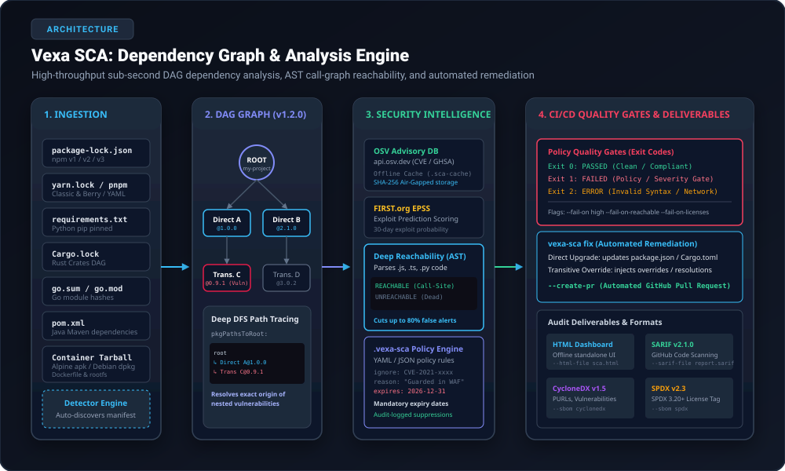
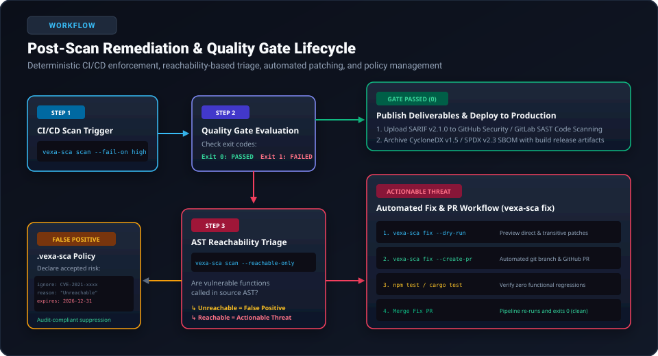

# Vexa SCA Open Source: Dependency Vulnerability & License Security Engine

## Executive Overview

**Vexa SCA Open Source** is a developer-first Software Composition Analysis (SCA) and license compliance engine built natively in Rust. Designed as a high-throughput, sub-second enterprise-grade solution, Vexa SCA scans direct and transitive open-source dependencies across multiple packaging ecosystems, calculates deep call-graph Abstract Syntax Tree (AST) reachability to eliminate false positives, audits copyleft intellectual property risks, generates compliant SBOMs, and automates remediation via lockfile patching and automated pull requests.

Modern software applications are constructed from upwards of 80–90% open-source third-party dependencies. While open source accelerates velocity, modern software supply chain attacks and severe vulnerabilities (e.g., Log4Shell, Prototype Pollution, Remote Code Execution) frequently manifest deep inside indirect, nested sub-dependencies. Vexa SCA provides continuous visibility, actionable prioritization, and deterministic remediation throughout the Software Development Life Cycle (SDLC) on **Linux**, **macOS**, and **Windows**.

---

## Vexa SCA Core Capabilities & Industry-Standard SCA Standards

Vexa SCA implements full compliance with modern DevSecOps standards and Software Composition Analysis benchmarks:

| Security & Compliance Area | Industry-Standard Benchmark | Vexa SCA Engine (`vexa-sca`) | Native Architecture Advantage |
| :--- | :--- | :--- | :--- |
| **CLI Scan & Audit** | Local developer terminal test | `vexa-sca scan` (or `vexa-sca test`) | Sub-second pure Rust execution; zero external runtime dependencies. |
| **Reachability Analysis** | Call-graph execution verification | `vexa-sca scan --reachable-only` | **Native static AST analysis**: Eliminates up to 80% of inactive false positives. |
| **Exploit Prediction** | FIRST.org EPSS probability | `vexa-sca scan --epss-threshold 0.20` | Real-world 30-day weaponization probability filtering (0.0 to 1.0). |
| **Automated Remediation** | Manifest & lockfile patching | `vexa-sca fix --create-pr` | In-place direct bump + transitive `overrides`/`resolutions` + automated GitHub PR. |
| **License Compliance** | SPDX license risk classification | `vexa-sca licenses --all` | Categorizes Permissive, Weak Copyleft, and Strong Copyleft with quality gates. |
| **Policy as Code** | Declarative repo-level policy | `.vexa-sca` / `.vexa-sca.json` | YAML/JSON policy-as-code with mandatory expiration date enforcement. |
| **Deterministic Quality Gates** | Zero-trust CI/CD pass/fail gates | `vexa-sca scan --fail-on high` | Multi-dimensional gates: `--fail-on-reachable`, `--fail-on-licenses`, `--fail-on-unmaintained`. |
| **Standard SBOM Generation** | Executive Order 14028 / NTIA | `vexa-sca scan --sbom cyclonedx` | Native **CycloneDX v1.5** & **SPDX v2.3** JSON export out of the box. |
| **Container & OS Scanning** | Base image & OS package audit | `vexa-sca container <image.tar>` | Scans Alpine `apk`, Debian/Ubuntu `dpkg`, Dockerfiles, and rootfs without Docker daemon. |
| **Single Package Audit** | Isolated package evaluation | `vexa-sca test lodash@4.17.15` | Instantly audits any package version without creating a project manifest. |

---

## Architecture & Dependency Graph Model

Vexa SCA scans your project manifest and lockfiles to reconstruct a Directed Acyclic Graph (DAG) representing the complete hierarchy of direct and transitive dependencies (conforming to the Vexa DepGraph Schema v1.2.0).



```text
┌────────────────────────────────────────────────────────────────────────────────────────┐
│                                VEXA SCA ARCHITECTURE                                   │
└────────────────────────────────────────────────────────────────────────────────────────┘

  1. INGESTION              2. DAG GRAPH (v1.2.0)       3. INTELLIGENCE           4. OUTPUTS & REMEDIATION
 ┌──────────────────────┐  ┌───────────────────────┐   ┌──────────────────────┐  ┌────────────────────────┐
 │ package-lock.json    │  │ Root Application      │   │ OSV Advisory DB      │  │ Terminal / JSON / MD   │
 │ yarn.lock / pnpm     │──┼─► Direct Dep A@1.0.0  │───┼─► api.osv.dev        │──┼─► Interactive HTML UI  │
 │ requirements.txt     │  │   ↳ Trans Dep C@0.9.1 │   │ FIRST.org EPSS       │  │ SARIF v2.1.0 (GitHub)  │
 │ Cargo.lock / go.sum  │  │ Direct Dep B@2.1.0    │   │ AST Call-Graph Check │  │ CycloneDX & SPDX SBOM  │
 │ pom.xml / Containers │  │ (pkgPathsToRoot DFS)  │   │ .vexa-sca Policy     │  │ vexa-sca fix & PRs     │
 └──────────────────────┘  └───────────────────────┘   └──────────────────────┘  └────────────────────────┘
```

### Key Architectural Concepts
1. **Node vs Package Coordinate**: Each component in the DAG maintains a distinct `nodeId` (positional identifier in the dependency hierarchy) and `pkgId` (canonical coordinate `name@version`), preventing collision across multi-version transitive dependency trees.
2. **Deep-Path DFS Tracing (`pkgPathsToRoot`)**: For every vulnerability located in a nested dependency, Vexa SCA traverses backwards from child to parent, displaying the exact dependency introduction chain (e.g., `my-app` -> `express@4.18.2` -> `body-parser@1.20.1` -> `qs@6.11.0`).
3. **AST Call-Graph Reachability**: Rather than reporting static package presence, Vexa SCA scans your application source code (`.js`, `.jsx`, `.ts`, `.tsx`, `.py`) using Abstract Syntax Tree traversal to confirm whether vulnerable exports and functions are actively imported and invoked.
4. **Resilient Offline Cache**: Vulnerability lookups are cached locally under `.sca-cache/` using SHA-256 digest keys, enabling air-gapped security audits and zero-latency repeated CI/CD pipeline scans.

---

## Supported Ecosystems & Manifest Detection Matrix

Vexa SCA automatically detects the project type by evaluating lockfiles and manifests in the target directory in a deterministic order of precedence:

| Ecosystem | Detected File(s) | Detection Priority | Transitive Resolution | Automated Fix (`vexa-sca fix`) | Lockfile Preparation Command |
| :--- | :--- | :--- | :--- | :--- | :--- |
| **Node.js (npm)** | `package-lock.json` | 1 | Full (v1, v2, v3 lockfiles) | In-place lockfile update + `overrides` | `npm install --package-lock-only` |
| **Node.js (Yarn)** | `yarn.lock` | 2 | Full (Classic & Berry) | In-place lockfile update + `resolutions` | `yarn install --mode update-lockfile` |
| **Node.js (pnpm)** | `pnpm-lock.yaml`, `pnpm-lock.yml` | 3 | Full (YAML format) | In-place lockfile update + `overrides` | `pnpm install --lockfile-only` |
| **Python** | `requirements.txt` | 4 | Pinned & unpinned declarations | In-place version bump & transitive pins | `pip freeze > requirements.txt` |
| **Rust (Cargo)** | `Cargo.lock` | 5 | Full package dependency graph | Direct `Cargo.toml` bump + `Cargo.lock` update | `cargo generate-lockfile` |
| **Go** | `go.sum`, `go.mod` | 6 | Exact module version hashes | Manual recommendation (`go get <pkg>@<ver>`) | `go mod tidy` |
| **Java (Maven)** | `pom.xml` | 7 | Direct `<dependencies>` inspection | Manual recommendation (`<version>` bump) | `mvn dependency:resolve` |
| **Containers / OS** | `.tar`, `.tar.gz`, `Dockerfile`, rootfs | Standalone command (`container`) | Alpine `apk`, Debian/Ubuntu `dpkg` | Base image upgrade recommendations | `docker save -o image.tar <image:tag>` |

> [!IMPORTANT]
> **Deterministic Manifest Rule**: Following DevSecOps best practices, Vexa SCA requires or strongly recommends a committed **lockfile** (`package-lock.json`, `yarn.lock`, `pnpm-lock.yaml`, `Cargo.lock`, `go.sum`). Unlocked manifests (`package.json`, `requirements.txt` with loose ranges) cannot guarantee deterministic dependency resolution between developer workstations and CI runners.

---

## Prerequisites (Pre-Scan Setup)

Before executing Vexa SCA scans, ensure your host environment satisfies the following requirements based on your operating system and deployment method:

### 1. System & Architecture Support

| Operating System | Supported Architectures | Minimum Version | Shell / Terminal |
| :--- | :--- | :--- | :--- |
| **Linux** | x86_64, aarch64 (ARM64), musl/Alpine | glibc 2.28+ or Alpine Linux 3.16+ | Bash, Zsh, Dash, sh |
| **macOS** | Apple Silicon (M1, M2, M3, M4), Intel x86_64 | macOS 11.0 (Big Sur) or newer | Zsh, Bash |
| **Windows** | x86_64 (64-bit AMD/Intel) | Windows 10, 11, or Windows Server 2019+ | PowerShell 5.1/7+, CMD, Git Bash, WSL2 |

### 2. Network & Proxy Prerequisites
- **Direct Internet Access**: Outbound HTTPS on TCP port 443 to `api.osv.dev` and `epss.cyentia.com` (or `first.org`).
- **Corporate Proxy**: Standard proxy environment variables (`HTTP_PROXY`, `HTTPS_PROXY`, `NO_PROXY`) are automatically respected by the native `rustls` network client.
- **Air-Gapped Environments**: Pre-populate the `.sca-cache/` directory in the project root. When cache hits occur, Vexa SCA performs 100% offline scanning with zero network packets emitted.

### 3. Toolchain & Installation Prerequisites

Choose **one** of the three installation pathways:

#### Pathway A: Standalone Native Binary (Zero Prerequisites)
No compilers, runtimes, or external C libraries (OpenSSL) are required. The binary is statically compiled with native `rustls-tls` and `miniz_oxide`.

#### Pathway B: Rust / Cargo Toolchain (For Developers Building from Source)
- Rust `v1.75.0` or later with `cargo`.
  - **Linux / macOS**: `curl --proto '=https' --tlsv1.2 -sSf https://sh.rustup.rs | sh`
  - **Windows**: `winget install Rustlang.Rustup` or download [rustup-init.exe](https://rustup.rs)

#### Pathway C: Node.js / NPX Launcher (For JavaScript / TypeScript Workstations)
- Node.js `v16.0.0+` and npm `v8.0.0+`.
  - **Linux**: Available via distro package manager or `nvm`.
  - **macOS**: `brew install node`
  - **Windows**: `winget install OpenJS.NodeJS.LTS`

### 4. Project Manifest Prerequisites (Pre-Scan Preparation)

Run the appropriate command in your project directory prior to scanning to ensure lockfiles are freshly synchronized:

- **npm**:
  ```bash
  npm install --package-lock-only
  ```
- **Yarn**:
  ```bash
  yarn install --mode update-lockfile
  ```
- **pnpm**:
  ```bash
  pnpm install --lockfile-only
  ```
- **Python**:
  ```bash
  pip freeze > requirements.txt
  ```
- **Rust**:
  ```bash
  cargo check
  ```
- **Go**:
  ```bash
  go mod tidy
  ```
- **Maven**:
  ```bash
  mvn dependency:resolve
  ```

---

## Cross-Platform Installation Guide

### Option 1: Standalone Binary Download (Recommended for Production & CI)

#### Linux (x86_64 / ARM64)
```bash
# Download and unpack native release binary
curl -sSL "https://github.com/noviqtechnologies/vexa-sca/releases/latest/download/vexa-sca-linux-x86_64.tar.gz" | tar -xz

# Move to standard system path
sudo mv vexa-sca /usr/local/bin/vexa-sca
sudo chmod +x /usr/local/bin/vexa-sca

# Verify installation
vexa-sca --version
```

#### macOS (Apple Silicon & Intel)
```zsh
# Download release tarball
curl -sSL "https://github.com/noviqtechnologies/vexa-sca/releases/latest/download/vexa-sca-macos-arm64.tar.gz" | tar -xz

# Install into user PATH
sudo mv vexa-sca /usr/local/bin/vexa-sca
sudo chmod +x /usr/local/bin/vexa-sca

# Verify installation
vexa-sca --version
```

#### Windows (PowerShell 5.1 / 7+)
```powershell
# 1. Create a dedicated bin directory in your User profile
New-Item -ItemType Directory -Force -Path "$HOME\bin"

# 2. Download and expand release archive
Invoke-WebRequest -Uri "https://github.com/noviqtechnologies/vexa-sca/releases/latest/download/vexa-sca-windows-x86_64.zip" -OutFile "$HOME\bin\vexa-sca.zip"
Expand-Archive -Path "$HOME\bin\vexa-sca.zip" -DestinationPath "$HOME\bin" -Force
Remove-Item "$HOME\bin\vexa-sca.zip"

# 3. Add to user PATH permanently
$UserPath = [Environment]::GetEnvironmentVariable("Path", "User")
if ($UserPath -notlike "*$HOME\bin*") {
    [Environment]::SetEnvironmentVariable("Path", "$UserPath;$HOME\bin", "User")
    $env:Path += ";$HOME\bin"
}

# 4. Verify installation
vexa-sca.exe --version
```

---

### Option 2: Cargo Global Install (Cross-Platform)

On any OS with Rust installed, install directly from the source repository:

```bash
cargo install --git https://github.com/noviqtechnologies/vexa-sca.git

# Available on all platforms
vexa-sca --help
```

---

### Option 3: Node.js / NPX Cross-Platform Wrapper

Run via npm without installing a separate binary:

```bash
# Ad-hoc execution via NPX (Linux, macOS, Windows)
npx vexa-sca scan

# Or install globally via npm
npm install -g vexa-sca
vexa-sca scan
```

---

### Option 4: Docker Container (Any OS with Docker Installed)

Run zero-install containerized scans in pipelines or local Docker hosts:

```bash
# Linux / macOS
docker run --rm -v "${PWD}:/workspace" ghcr.io/noviqtechnologies/vexa-sca:latest scan /workspace

# Windows (PowerShell)
docker run --rm -v "${PWD}:/workspace" ghcr.io/noviqtechnologies/vexa-sca:latest scan /workspace
```

---

## Core Scanning Workflows

### 1. Basic Project Vulnerability Scan

Scan the current working directory or any explicit path:

```bash
# Scan current directory
vexa-sca scan

# Scan explicit directory
vexa-sca scan /path/to/my-application
```

Output includes:
- Detected ecosystem and manifest path.
- Total dependency nodes evaluated.
- Vulnerabilities grouped by severity (Critical, High, Medium, Low).
- Introduction paths to root (`pkgPathsToRoot`).
- Remediation guidance (fixed versions and upgrade paths).

---

### 2. Eliminating False Positives with Reachability Analysis

Standard SCA scanners trigger alerts when a vulnerable package is present in `package-lock.json`, even if the vulnerable function is never imported or called. Vexa SCA's static AST reachability engine traces actual call sites in `.js`, `.ts`, and `.py` code:

```bash
# Filter output strictly to exploitable vulnerabilities with confirmed call sites
vexa-sca scan --reachable-only
```

Example Reachability Output:
```text
[CRITICAL] CVE-2021-23337: Command Injection via template() in lodash@4.17.15
  Introduced through: my-service@1.0.0 ➔ express@4.18.2 ➔ lodash@4.17.15
  Reachability: REACHABLE (Confirmed in AST Call-Graph)
  Call Site: src/controllers/report.js:42:15 -> _.template(...)
  Remediation: Upgrade lodash to 4.17.21 or apply automated patch via `vexa-sca fix`.
```

---

### 3. Production-Only Dependencies

Ignore development-only tools (e.g., test runners, linters, bundlers like `jest`, `mocha`, `eslint`) to focus exclusively on production runtime attack surfaces:

```bash
vexa-sca scan --prod-only
```

---

### 4. Actionable-Only Filtering (Ignore Unfixed)

Hide vulnerabilities that have no official vendor patch or fix available, preventing backlog noise:

```bash
vexa-sca scan --ignore-unfixed
```

---

### 5. FIRST.org EPSS Exploit Likelihood Prioritization

Filter CVEs based on their real-world 30-day exploit likelihood score (0.0 to 1.0) published by FIRST.org:

```bash
# Only display vulnerabilities with >= 20% probability of active in-the-wild exploitation
vexa-sca scan --epss-threshold 0.20

# Strict production triage: Reachable in code AND weaponized in the wild
vexa-sca scan --reachable-only --epss-threshold 0.50
```

---

### 6. Single Package Audit (`vexa-sca test`)

Test an individual package coordinate without creating a dummy project:

```bash
# Test an npm package
vexa-sca test lodash@4.17.15

# Test a PyPI package
vexa-sca test requests@2.19.0 --ecosystem PyPI

# Test a Rust crate
vexa-sca test tokio@0.1.22 --ecosystem crates.io
```

---

### 7. Container & OS Package Scanning (`vexa-sca container`)

Scan container images, exported tarballs, Dockerfiles, or container rootfs directories for OS packages (Alpine `apk` and Debian/Ubuntu `dpkg`):

```bash
# Scan a saved Docker tarball
docker save -o my-service.tar my-service:latest
vexa-sca container my-service.tar

# Scan a Dockerfile for base image vulnerabilities
vexa-sca container Dockerfile

# Fail CI if High/Critical OS vulnerabilities are present
vexa-sca container my-service.tar --fail-on high
```

---

## Open-Source License Compliance & Auditing

Vexa SCA scans every package in your dependency graph against recognized SPDX license identifiers to protect against copyright infringement and viral copyleft license contamination:

```bash
# View license breakdown and flagged copyleft risks
vexa-sca licenses

# Display every individual package and its declared license
vexa-sca licenses --all

# Export license inventory in machine-readable JSON
vexa-sca licenses --json
```

### License Risk Categorization
- **Permissive (Low Risk)**: MIT, Apache-2.0, BSD-2-Clause, BSD-3-Clause, ISC. Free commercial use and redistribution without requiring source disclosure.
- **Weak Copyleft (Medium Risk)**: LGPL-2.1, LGPL-3.0, MPL-2.0, EPL-2.0. Requires modifications to the library itself to be open-sourced, but allows dynamic linking with proprietary code.
- **Strong Copyleft (High Risk)**: GPL-2.0, GPL-3.0, AGPL-3.0. Forces entire proprietary derivative applications to be licensed under open source terms if distributed.
- **Unknown (Unclassified)**: Missing or non-standard license string requiring legal review.

---

## Automated Remediation (`vexa-sca fix`)

Rather than leaving developers with raw vulnerability warnings, Vexa SCA automates the upgrade process across package ecosystems:

```bash
# 1. Preview proposed patches without modifying files
vexa-sca fix --dry-run

# 2. Apply in-place upgrades to package manifests and lockfiles
vexa-sca fix

# 3. Apply patches, commit changes, and open a GitHub Pull Request
vexa-sca fix --create-pr --repo owner/my-repo --token "$GITHUB_TOKEN"
```

### Remediation Mechanics by Ecosystem
- **npm / Yarn / pnpm**:
  - Direct dependencies are bumped in `package.json` to minimum non-vulnerable versions.
  - Transitive vulnerabilities are resolved by injecting deterministic `overrides` (npm / pnpm) or `resolutions` (Yarn) blocks.
  - A timestamped backup (`package.json.bak.<timestamp>`) is created automatically before disk modifications.
- **Python (`requirements.txt`)**:
  - Updates pinned versions (e.g., `urllib3==1.24.1` -> `urllib3==1.26.5`).
  - Appends explicit transitive security pins with inline audit comments.
- **Rust (`Cargo.toml` / `Cargo.lock`)**:
  - Updates direct dependencies in `Cargo.toml`.
  - Upgrades locked sub-dependencies in `Cargo.lock`.

---

## Policy-as-Code & Suppressions (`.vexa-sca`)

To manage accepted business risks, temporary mitigations, or unreachable legacy components, Vexa SCA supports declarative policy files (`.vexa-sca` or `.vexa-sca.json`) placed in the repository root.

### Supported Policy Syntax (`.vexa-sca`)

```yaml
version: "v1.0.0"
ignore:
  # Suppress by CVE ID
  CVE-2021-23337:
    reason: "Prototype pollution call site is guarded by custom input sanitization in api-gateway."
    expires: "2026-12-31"
    created: "2026-01-15"

  # Suppress by GHSA Advisory ID
  GHSA-35jh-r3h4-6jhm:
    reason: "Component is used exclusively in offline build scripts; not deployed to production."
    expires: "2026-06-30"

  # Suppress by exact Package Coordinate
  "minimist@0.0.8":
    reason: "Legacy internal tool scheduled for total deprecation in Q3."
    expires: "2026-09-30"
```

### Policy Execution Rules
1. **Mandatory Expiration**: If the current date exceeds the `expires` timestamp (format `YYYY-MM-DD`), Vexa SCA automatically revokes the suppression and fails CI/CD quality gates.
2. **Audit Tracking**: Suppressed vulnerabilities are excluded from terminal alert counts but are documented in JSON, SARIF, and HTML reports under the `suppressed` metadata section for security auditor verification.
3. **Custom Policy Path**: Pass `--policy /path/to/custom-policy.yaml` to enforce centralized organizational policies.

---

## CI/CD Quality Gates & Exit Codes

Vexa SCA integrates deterministically into automated CI/CD pipelines (GitHub Actions, GitLab CI, Azure Pipelines, Jenkins, Bitbucket).

### Standard CLI Exit Codes

| Exit Code | Status | Meaning | Pipeline Consequence |
| :---: | :--- | :--- | :--- |
| **`0`** | **PASSED** | Scan completed successfully; no quality gate policies were violated. | Pipeline continues to build/deploy stage. |
| **`1`** | **FAILED** | Quality gate threshold violated (e.g., High/Critical vulnerability or copyleft license detected). | Pipeline terminates immediately, blocking deployment. |
| **`2`** | **ERROR** | Execution error (e.g., target directory not found, invalid manifest syntax, network failure). | Pipeline job errors out with diagnostics. |

### Quality Gate Flag Options

```bash
# Fail if any Critical vulnerability is found
vexa-sca scan --fail-on critical

# Fail on High or Critical vulnerabilities
vexa-sca scan --fail-on high

# Fail ONLY if a High/Critical vulnerability is confirmed reachable in source AST
vexa-sca scan --fail-on high --fail-on-reachable

# Fail if Strong Copyleft licenses (GPL/AGPL) are introduced
vexa-sca scan --fail-on-licenses strong-copyleft

# Fail on unmaintained or deprecated packages
vexa-sca scan --fail-on-unmaintained
```

---

## Multi-Format Reporting & Deliverables

Generate security deliverables for compliance, auditing, and developer dashboards:

### 1. Interactive Single-File HTML Dashboard (`--html-file`)
Generates an offline-ready, standalone HTML dashboard with dark glassmorphism styling, live search, severity filtering, and call-site inspectors:
```bash
vexa-sca scan --html-file sca-report.html
```

### 2. Standard OASIS SARIF v2.1.0 (`--sarif-file`)
Export native SARIF for automated ingestion into GitHub Security Code Scanning and GitLab SAST:
```bash
vexa-sca scan --sarif-file results.sarif
```

### 3. CycloneDX v1.5 & SPDX v2.3 SBOM (`--sbom-file`)
Generate machine-readable Software Bill of Materials with Package URLs (PURLs), license metadata, and known vulnerability records:
```bash
# CycloneDX v1.5 JSON
vexa-sca scan --sbom cyclonedx --sbom-file cyclonedx-sbom.json

# SPDX v2.3 JSON
vexa-sca scan --sbom spdx --sbom-file spdx-sbom.json
```

### 4. Machine-Readable JSON (`--json`)
Pipe structured findings directly into custom DevSecOps tools or `jq`:
```bash
vexa-sca scan --json > audit.json
```

---

## Post-Scan Implementation Steps

Following a completed Vexa SCA scan, execute the appropriate remediation and verification steps:



```text
┌──────────────────────────────────────────────────────────────────────────────────────────────────────────┐
│                             POST-SCAN REMEDIATION & QUALITY GATE LIFECYCLE                               │
└──────────────────────────────────────────────────────────────────────────────────────────────────────────┘

       [ 1. Trigger Scan: vexa-sca scan --fail-on high ]
                                │
                                ▼
                 [ 2. Quality Gate Evaluation ]
                                │
              ┌─────────────────┴─────────────────┐
              │                                   │
         Exit Code 0                         Exit Code 1
      (Quality Gate Passed)             (Policy Gate Violated)
              │                                   │
              ▼                                   ▼
 [ Publish Deliverables ]               [ 3. AST Reachability Triage ]
  • Upload SARIF to GitHub               vexa-sca scan --reachable-only
  • Archive CycloneDX SBOM                        │
  • Deploy to Production              ┌───────────┴───────────┐
                                      ▼                       ▼
                               [ Unreachable ]          [ Reachable ]
                               False Positive          Actionable Risk
                                      │                       │
                                      ▼                       ▼
                             [ .vexa-sca Policy ]    [ Automated Remediation ]
                              Add suppression with    1. vexa-sca fix --dry-run
                              reason & expiry date    2. vexa-sca fix --create-pr
                                                      3. Run tests (npm/cargo/pytest)
                                                      4. Merge Fix PR
```

### Checklist of Post-Scan Actions

1. **Evaluate Exit Code**:
   - If `0`: Proceed with pipeline deployment.
   - If `1`: Review the terminal summary or open the generated `sca-report.html`.

2. **Isolate Exploitable Vulnerabilities**:
   - Execute `vexa-sca scan --reachable-only` to separate true runtime threats from inactive dependencies.

3. **Remediate with Automated Fix**:
   - Run `vexa-sca fix --dry-run` to inspect proposed dependency bumps.
   - Apply fixes with `vexa-sca fix`.
   - **Crucial Post-Fix Verification**: Run your application test suite (`npm test`, `cargo test`, or `pytest`) to ensure dependency upgrades did not introduce functional regressions.

4. **Address Unfixable or False Positive Findings**:
   - If an issue is verified unreachable or has an upstream fix pending, add an auditable suppression entry in `.vexa-sca` with a valid business reason and expiration date.

5. **Publish Compliance Deliverables**:
   - In CI/CD pipelines, upload `results.sarif` to GitHub Security (`github/codeql-action/upload-sarif`) or GitLab SAST.
   - Store `cyclonedx-sbom.json` alongside release binaries for regulatory compliance (e.g., Executive Order 14028 / EU Cyber Resilience Act).

---

## Cross-Platform Troubleshooting & FAQs

### 1. "No supported lockfile found in directory"
- **Cause**: Vexa SCA requires a recognized lockfile to construct a deterministic DAG.
- **Resolution**:
  - **Node.js**: Run `npm install --package-lock-only`, `yarn install`, or `pnpm install`.
  - **Python**: Run `pip freeze > requirements.txt`.
  - **Rust**: Run `cargo check` to generate `Cargo.lock`.
  - **Go**: Run `go mod tidy` to generate `go.sum`.

### 2. Windows PowerShell Execution Policy Restrictions
- **Cause**: Running `npx vexa-sca` or scripts in PowerShell displays `running scripts is disabled on this system`.
- **Resolution**:
  Run PowerShell as Administrator and execute:
  ```powershell
  Set-ExecutionPolicy -ExecutionPolicy RemoteSigned -Scope CurrentUser
  ```
  Alternatively, invoke the standalone native binary directly:
  ```powershell
  .\vexa-sca.exe scan
  ```

### 3. Air-Gapped / Offline CI Pipeline Failures
- **Cause**: CI runner has no outbound internet access to `api.osv.dev`.
- **Resolution**:
  Pre-seed the `.sca-cache/` directory in your container or workspace before running the scan. Vexa SCA will seamlessly serve vulnerability queries directly from disk.

### 4. Git Authentication Error during `vexa-sca fix --create-pr`
- **Cause**: Git CLI or GitHub API lacks sufficient write permissions.
- **Resolution**:
  Ensure `GITHUB_TOKEN` or `GH_TOKEN` is exported in your environment with `contents: write` and `pull-requests: write` permissions:
  ```bash
  export GITHUB_TOKEN="ghp_yourPersonalAccessTokenHere"
  vexa-sca fix --create-pr
  ```

---

## Summary Command Reference

```bash
# Basic Scan
vexa-sca scan [path]

# Reachable-Only Vulnerabilities (AST Traced)
vexa-sca scan --reachable-only

# EPSS Exploit Prediction Filter (>= 20% probability)
vexa-sca scan --epss-threshold 0.20

# Production Dependencies Only
vexa-sca scan --prod-only

# Quality Gate (Fail on High/Critical reachable)
vexa-sca scan --fail-on high --fail-on-reachable

# Standalone Interactive HTML Dashboard
vexa-sca scan --html-file sca-report.html

# OASIS SARIF v2.1.0 Export (GitHub Code Scanning)
vexa-sca scan --sarif-file results.sarif

# CycloneDX v1.5 / SPDX v2.3 SBOM Export
vexa-sca scan --sbom cyclonedx --sbom-file sbom.json

# Copyleft License Audit
vexa-sca licenses --all --fail-on strong-copyleft

# Automated Remediation & GitHub Pull Request
vexa-sca fix --create-pr

# Container & OS Package Scan
vexa-sca container my-image.tar --fail-on high
```
